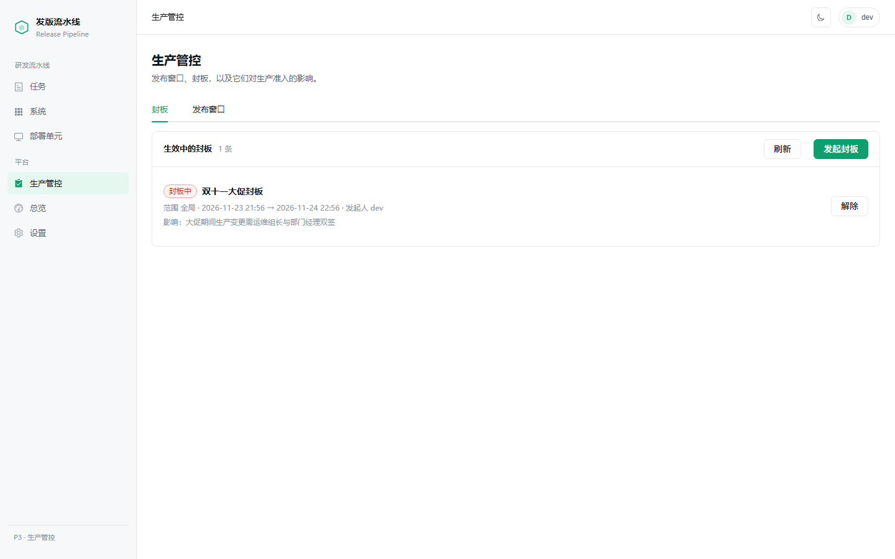
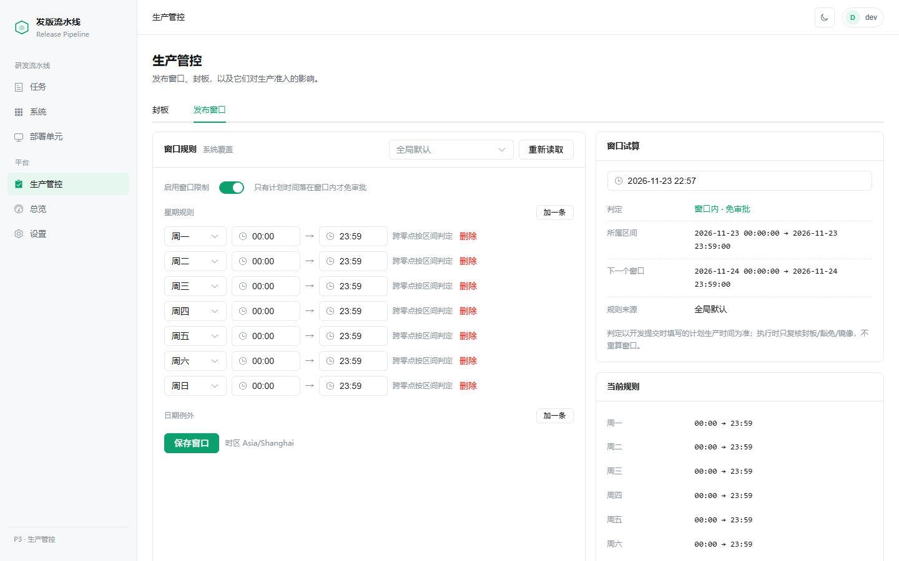

# 前端设计定稿 · 石墨中性（Graphite）

| 项 | 内容 |
|---|---|
| 风格 | 简约商务，中性灰阶 + 单一强调色，信息密度中高，状态用点状标记 |
| 技术 | Vue 3 + TypeScript + Vite + Vue Router + Element Plus（全量主题定制） |
| 主题 | 明/暗两套 CSS 变量，跟随系统，可手动切换并持久化 |
| 数据 | 直连本地后端（Vite proxy → `http://127.0.0.1:8080`），身份用 `X-User-Id` |

## 1. 设计原则

1. **颜色只承担语义**：强调色只有一种（青绿），用于主操作、当前态与链接；红/琥珀只用于失败/阻塞；其余全是灰阶。不做彩色渐变、不做大面积色块。
2. **分组靠空间与细线**：默认无阴影，卡片 1px 边框 + 8px 圆角；只有浮层（弹窗、抽屉、下拉）带阴影。
3. **状态用点不用块**：状态 = 6px 圆点 + 文字，避免表格里一片彩色标签。
4. **数字用等宽**：耗时、进度、ID、分支名一律 `font-variant-numeric: tabular-nums` 或等宽字体，保证纵向对齐。
5. **动效克制**：仅 `opacity/transform` 的 120–180ms 过渡；进行中的状态点有缓慢呼吸，其余不动。

## 2. 设计令牌

| 令牌 | Light | Dark | 用途 |
|---|---|---|---|
| `--bg` | `#FFFFFF` | `#0B0D10` | 页面底色 |
| `--surface` | `#F7F8FA` | `#14171A` | 侧栏、表头、卡片底 |
| `--surface-2` | `#FFFFFF` | `#1A1E24` | 卡片、弹窗 |
| `--border` | `#E6E8EB` | `#23272E` | 1px 分隔线 |
| `--border-strong` | `#D5D9DE` | `#2E343C` | 输入框、可交互边界 |
| `--text` | `#14171A` | `#E6E8EB` | 主文本 |
| `--text-2` | `#5B6570` | `#9BA1A6` | 次文本 |
| `--text-3` | `#8A939C` | `#6B7280` | 弱文本、占位 |
| `--accent` | `#0E9F6E` | `#2DD4A7` | 主操作、当前态 |
| `--accent-weak` | `#E6F7F0` | `#0F2A22` | 强调底（选中行、当前步骤） |
| `--danger` | `#D92D20` | `#F97066` | 失败 |
| `--warn` | `#B54708` | `#FDB022` | 阻塞/PAUSED |
| `--info` | `#175CD3` | `#84ADFF` | 中性信息 |
| `--radius` | `8px` | `8px` | 卡片/输入框 |
| `--shadow` | `0 1px 2px rgba(16,24,40,.06)` | `0 1px 2px rgba(0,0,0,.4)` | 浮层 |

字号：12 / 13 / 14（正文）/ 16（标题）/ 20（页面标题）。行高 1.6。
字体：`Inter, "PingFang SC", "Microsoft YaHei", system-ui`；数字与分支用 `ui-monospace, "JetBrains Mono", Consolas`。

## 3. 页面结构

```
┌──────────────────────────────────────────────────────────┐
│ 侧栏 220px          │  顶栏 56px：面包屑 · 主题切换 · 身份  │
│ · 总览               ├───────────────────────────────────┤
│ · 任务               │                                   │
│ · 系统             │  内容区 max-width 1280，padding 24  │
│ · 部署单元           │                                   │
│ · 设置               │                                   │
└──────────────────────────────────────────────────────────┘
```
窄屏（<960px）侧栏收成图标栏；<720px 内容单列。

## 4. 页面与关键组件

| 路由 | 页面 | 关键内容 |
|---|---|---|
| `/` | 总览 | 三个统计卡（进行中任务、待处理变更项、最近发布）+ 最近任务表 |
| `/tasks` | 任务列表 | 筛选（系统/状态/关键字）+ 表格 + 新建任务弹窗 |
| `/tasks/:id` | 任务详情 | 进度条 + 变更项表格（状态点/门禁列/发布按钮）+ 成员 + 新建变更项 |
| `/releases/:publishNo` | 发布内容 | 四节点步骤条、节点任务卡、**验证确认面板**（见 §8）、状态点、发布记录 Tab |
| `/subsystems` | 系统 | 列表 + 新建 |
| `/subsystems/:id` | 系统详情 | 基本信息 + 部署单元列表 |
| `/units/:id` | 部署单元 | 概述、CODING 任务绑定（三必填 + 日常可选）、环境 DE 列表 |
| `/settings` | 设置 | 主题、身份（X-User-Id）、后端连通性、CODING 对接状态（只读提示） |

组件（自研，放在 `web/src/components`）：
`StatusDot`（状态点 + 文案）、`PageHeader`、`DataSection`（标题 + 操作 + 内容）、`EmptyState`、`KeyValue`（键值对）、`StepBar`（四节点步骤条）、`CodeText`（等宽短文本）。

## 5. 状态语义

| 域 | 值 | 颜色 |
|---|---|---|
| 变更项 | PENDING / BUILDING / TESTING / GATE_PENDING / SUBMITTED / PENDING_APPROVAL / READY | 灰 / 强调 / 强调 / 强调 / 强调 / 琥珀 / 强调 |
| 变更项 | PROD_DEPLOYING / DONE | 强调 / 绿（成功） |
| 变更项 | GATE_FAILED / FAILED / REJECTED | 红 |
| 变更项 | CLOSED / TERMINATED / ROLLED_BACK | 灰 |
| 实例 | PENDING / RUNNING / PAUSED | 灰 / 强调（呼吸）/ 琥珀 |
| 实例 | DONE / FAILED | 绿 / 红 |
| 任务节点 | PENDING / RUNNING / SUCCESS / FAILED / TIMEOUT / SKIPPED | 灰 / 强调 / 绿 / 红 / 红 / 灰 |
| 生命周期 | ACTIVE / INACTIVE（部署单元、系统） | 绿 / 灰 |
| 检查项 | PENDING / RUNNING / PASS / FAIL / TIMEOUT / INVALID / UNKNOWN | 灰 / 强调 / 绿 / 红 / 红 / 灰 / 琥珀 |
| 缺陷等级 | NONE / S3 / S2 / S1 / S0 | 灰 / 灰 / 琥珀 / 红 / 红（文字 chip，不用色点） |

同一个原始值在不同域里含义可能不同（例如 `PENDING` 在变更项是「待发布」、在节点是「待开始」），所以 `StatusDot`/`statusLabel` 带 `domain` 参数；新增状态值先补 `format.ts` 的 `LABELS`/`TONES`，否则会退化成裸枚举展示。

## 6. 明暗切换

- `data-theme="light|dark"` 挂在 `<html>`；首次加载取 `localStorage.theme`，无则跟随 `prefers-color-scheme`。
- Element Plus 通过覆盖其 CSS 变量（`--el-bg-color`、`--el-text-color-primary` 等）映射到本设计令牌，不另写一套组件样式。
- 覆盖块的选择器必须是 `:root, :root[data-theme='light'], :root[data-theme='dark']`：EP 自带深色变量挂在 `html.dark`（特异性 0,1,1），普通 `:root`（0,1,0）会被压过，深色下主色会退回 EP 的默认蓝。主色/成功/危险/警告/信息五组 light-3~9、dark-2 都用 `color-mix` 从令牌派生，保证两套主题同源。
- 切换时只过渡 `background-color / color / border-color`，避免整页闪烁。

## 7. 后端依赖（本步需要补的读接口）

| 方法 | 路径 | 用途 |
|---|---|---|
| GET | `/tasks?page&size&subsystemId&status&keyword` | 任务列表 |
| GET | `/tasks/{id}` | 任务详情（含成员与进度） |
| GET | `/tasks/{id}/items` | 变更项列表（含单元名） |
| GET | `/units/{id}/coding-tasks` | 部署单元详情页回显已有 CODING 绑定 |
| GET | `/api/v1/items/{itemId}/gate` | 验证确认面板（两道门、检查、豁免、准入） |
| GET | `/api/v1/me` | 当前身份与权限点，用于「禁用并说明原因」 |

其余页面复用已有接口：`/subsystems`、`/units`、`/units/{id}/env-des`、`/api/v1/items`、`/api/v1/items/{id}/publish`、`/api/v1/releases/{publishNo}`。

部署单元详情页的「CODING 任务绑定」表单先读后写：读出当前绑定并回填，逐个字段用圆点标记 `已绑定`；保存按任务类型 upsert，留空的类型保留原绑定。「发布前置条件」清单把后端的准入规则（三类绑定 + 测试 DE + 生产族 DE）前置到页面上，避免用户点发布才收到 40011。

`params_json` 列是 MySQL `JSON` 类型，读写会经过服务端规范化（例如 `{"branch": "release/202611"}` 带空格、键顺序按 MySQL 规则），前端只按 JSON 语义解析 `params.branch`，不做字符串比较。

### 7.1 优化轮次（2026-11-22）

- **术语**：界面与文档统一叫「系统」，路由与接口仍是 `/subsystems`；库表与 Java 类保留 `subsystem` 前缀，作为命名债记在台账里。
- **部署单元列表**：新增「模块」「标签」两个精确筛选与「模块 / 标签」列（标签显示为 `#value` 小徽标），筛选条改为 `系统 / 类型 / 模块 / 标签 / 名称`。
- **部署单元详情**：新增「编辑」弹窗，一次改完基本信息；保存是整体替换，留空的可选字段会被清空，这条规则直接写在弹窗底部。基本信息卡新增「模块」「标签」两行，与「模块路径」并列以体现两者不同。
- **CODING 绑定改为选择**：任务输入框换成可搜索下拉，候选按所属系统的 CODING 项目分别拉取构建 / 部署两个命名空间；拉取失败时保留 `allow-create`，并在表单下方用警示色说明原因——「连不上」不能被误读成「项目没有任务」。
- **新建变更项**：选中部署单元后立即读出它的 BUILD 只读分支并显示（只读、不可改），没有分支时把「创建」按钮置灰并给出去配置的入口，把 40011 从「点提交才报错」提前成「选单元就知道」；后端仍返回 40011 兜底，前端把它翻译成同一句人话。
- **生命周期状态**：部署单元与系统的 `ACTIVE / INACTIVE` 补上中文标签与色点（启用 / 停用），不再裸显示枚举。

## 8. P2 · 验证确认面板（2026-11-22）

发布内容页的「验证确认」节点不再是一排 `CHECK` 任务，而是一块**判定面板**：先给结论与算术，
再给证据与动作，最后给「能不能上生产」的回答。浅色与深色两套见
`shots/release-gate-light.png` / `release-gate-dark.png`（全通过）与
`shots/release-gate-waiver-light.png` / `release-gate-waiver-dark.png`（中危待豁免）。


**结构（自上而下）**

1. **两道门并排**：检查门禁（`passed/total` + 最高等级 chip + 结论色点）、测试门禁（通过/未通过 +
   通过人 + 时间 + 不通过原因）。两列而不是一列，直接对应「两个维度正交」的建模（V19 拆列）。
2. **结论条**：一句话结论（`检查阻断：1 项未通过，最高等级 中危（可申请豁免）`）+ 计算过程要点，
   红/绿/强调三种底色对应阻断、通过、检查中。
3. **动作行**：`测试通过 / 测试不通过 / 撤回通过`，右侧一句话解释规则（C18/C19）。
   **不可用的动作禁用并给出原因**，不隐藏——原因优先用状态（已通过、当前不是测试中），其次用权限
   （从 `GET /api/v1/me` 读到的 `gate:test-pass` / `gate:test-revoke`）。
4. **检查明细**：按阶段分两组（镜像级 4 项 / 环境级 3 项），每行「状态点 + 名称 + 等级 chip + 问题数 +
   摘要 + 完成时间 + 报告 + 刷新」。等级用文字 chip 而不是颜色编码：高危红、中危琥珀、低危灰。
5. **豁免区**：中危且无生效豁免时给「申请豁免」；有待审批单时显示申请人/原因/到期与「批准 / 驳回」；
   到期或驳回的单据保留可见（`EXPIRED` / `REJECTED` 用红边 chip），避免「豁免去哪了」。
6. **生产准入**：`已满足` 时说明「可提交生产（P3 交付提交入口）」；未满足时逐条列出缺口
   （检查未完成 / 测试未通过 / 未产出镜像 / 检查对象与镜像不一致 / 变更项已结束）。

**交互规则**

- 任何动作成功后回到后端返回的最新面板（`POST` 返回整个 `GateView`），父页面同时刷新一次发布详情；
- 填原因的动作用 `ElMessageBox.prompt` 强制非空，原因成为留痕（`test_fail_reason` / `decide_reason`）；
- 刷新单项检查会把它重置为「执行中」，门禁随之后退成「检查中」——这正是「未完成不算通过」；
- 实例 `PAUSED` 时页头出现「恢复执行」，按钮 `title` 带出 `status_reason`，点下去若门禁未满足或
  节点尚未交付，后端拒绝并在消息里说明原因（不静默）。

## 9. CODING 对接（随 P2 之后，2026-11-22）

设置页从「说明哪里改配置」变成**能改配置**：整块「CODING 对接」放在页首，四个字段
（服务地址 / 团队 / 默认项目 / 访问凭证）+ 保存 / 测试连接。截图见
`shots/settings-light.png` / `shots/settings-dark.png`。


- **状态 chip**：未配置 / 已配置·未验证 / 已验证 / 上次校验失败。它来自 `last_probe_*`，
  所以「上次校验」不需要页面自己记。
- **凭证**：密码框，已配置时 placeholder 是「留空保留原凭证」，旁边写死 `tok-***`；
  页面永远拿不到明文，也不会把 `token` 回填。
- **测试连接**：结果条显示引擎原话 + 构建/部署任务数。成功时 `persisted:true` 才显示
  「已记录为上次校验结果」；改了字段再测显示「草稿测试：结果不写入配置」。
- **权限**：无 `setting:manage` 时不给表单，只给一句「需要平台管理员权限」，状态 chip 仍可见。
- 系统详情「CODING 项目」从只读改为行内「编辑」，提示「未填时使用平台连接的默认项目」。

## 10. 验收

- `npm run build` 通过，无 TS 报错；
- 明暗两套下所有页面文字对比度 ≥ WCAG AA（正文 4.5:1）；
- 后端未启动时，页面显示明确的连通性提示，不白屏；
- 任务 → 变更项 → 发布 → 发布内容 → 验证确认 的路径可完整走通（无 CODING 连接时发布结果为 FAILED，
  页面如实呈现；需要看门禁面板时用 `scripts/demo-gate.sql` 播种一次「检查已回传」的执行）。

## 11. P3 · 生产准入与生产管控（2026-11-23）

发布内容页的生产节点不再只有「提交生产发布」按钮，而是一块**生产准入**面板；侧栏新增
「生产管控」页，分「封板」「发布窗口」两个标签。截图：
`shots/release-prod-approval-light.png`（封板期双签）、`shots/release-prod-ready-light.png`
（免审待执行）、`shots/control-freezes-light.png`、`shots/control-window-light.png`，
深色对应 `-dark` 文件。





**生产准入面板（`AdmissionPanel.vue`）**

1. **状态头**：标题「生产准入」+ 状态 chip（待提交 / 待审批 / 待执行 / 生产中 / 已驳回…）+
   `快照 #id · 提交时间`。快照是提交那一刻的事实，面板不随窗口/封板变化改写它。
   整单重跑会把变更项送回「待提交」，此时最新快照属于**上一代**：头部标「（上一代 · 历史）」，
   正文整体换成「上一代快照已归档，重新提交会生成新快照」，不再把旧计划时间/封板/审批链
   当作当前证据（独立复审 B1）。
2. **快照网格**：计划生产时间、窗口判定（窗口内/外）、封板（`提交时处于封板期 · 双签` / `无`）、
   OA 工单、检查 / 测试、镜像短 sha、提交人。
3. **审批链**：`1 运维组长 待审批` → `2 部门经理 待审批` 逐行，当前待签行高亮；已签行带签批人与意见，
   驳回后未签步骤显示「已取消」。封板期即使是窗口内也必须是两步——这是设计 4.4 的双签，
   顺序要在页面上直接看出来。
4. **动作行**：`通过 / 驳回` 只对当前待签步骤开放，且需要该步骤的角色；不可用时禁用并说明原因
   （没有 `control:approve`、缺步骤角色、提交人不能自审）。驳回必须填原因。
   `执行生产发布` 在**复核未通过时直接禁用并列出原因**（封板/豁免/镜像），不再先让人点进确认框；
   生产重跑（`TESTING` + 实例停在 `PROD_DEPLOY` 的重跑）显示为 `执行生产重跑` 且可执行，
   `TESTING` 的其他情形说明「测试阶段不能执行生产」（独立复审 I1/M4）。
5. **提交入口**：`GATE_PENDING` 就给「提交生产发布」（不论是否留有上一代快照），抽屉里选计划时间 +
   填 OA 工单，可先「提交前校验」（只试算，不落库）；`REJECTED` 时给「重新提交」（新快照，旧链留史）；
   任何时刻可「刷新准入」。
6. **复核预览**：面板底部列出执行前复核的三项（封板 / 豁免 / 镜像），只说明「变了什么」，
   不重算窗口；被阻断时说明退回动作。封板提示按状态分档：`READY` 说「执行前复核会拦截」，
   `PROD_DEPLOYING` 才说「已暂停在批次边界」，`PENDING_APPROVAL` 说「需要双签」。

**生产管控页（`ControlView.vue`）**

- **封板标签**：`生效中的封板`、`待生效的封板`、`历史封板` 三段——已登记但尚未到开始时间的
  `ACTIVE` 封板在第二段列出，同样可以「解除」（独立复审 M3：误设的未来封板不能既看不到也解不了）；
  历史段显示状态与解除人/时间，最多 10 条。卡片含范围、起止、事由、影响、发起人；
  「解除」必填原因；「发起封板」抽屉（全局 / 指定系统、起止、事由、影响）。无
  `control:freeze` / `control:unfreeze` 时按钮隐藏并说明所需权限。
- **发布窗口标签**：启用窗口限制开关、星期规则（可加/删时间段；跨零点按区间判定，不拆日期归属）、
  日期例外（开放 / 关闭）、窗口试算（选时间点 → 在不在窗口内 + 下一个窗口）。保存走 `PUT /api/v1/windows`。
- 侧栏新增 `生产管控`；页脚阶段标记更新为 `P3 · 生产管控`。

**状态语义**

- 封板只拦生产：准入判定、在途转双签、执行复核；构建 / 测试 / 日常发布不受影响。
- 生产暂停（批次边界）只给「继续」一条路，继续会重跑执行前复核；通用「恢复执行」按钮对
  生产暂停**隐藏**，避免用 `/resume` 绕过复核。
- **未做**：全局封板横幅（封板状态目前只在准入面板与生产管控页呈现）；企微通知、紧急放行、
  单 DE 重试、停止发布（设计 §2 不在一期）。

**验收（P3）**

- `npm run build` 通过，无 TS 报错；`scripts/verify-p3-ui.mjs` 对发布页、封板页、窗口页断言
  选择器与文案，控制台错误为 0；
- 封板期提交后审批链出现 `运维组长 → 部门经理` 两步；两人分别通过后变「待执行」；
- 解除封板后窗口内的单自动回到「待执行」（待签步骤被收回，已签意见保留）；
- 未见浏览器控制台报错；空态（无封板 / 无快照）都有文案而不是空白。