# 前端设计定稿 · 石墨中性（Graphite）

| 项 | 内容 |
|---|---|
| 风格 | 简约商务，中性灰阶 + 单一强调色，信息密度中高，状态用点状标记 |
| 技术 | Vue 3 + TypeScript + Vite + Vue Router + Element Plus（全量主题定制） |
| 主题 | 明/暗两套 CSS 变量，跟随系统，可手动切换并持久化 |
| 数据 | 直连本地后端（Vite proxy → `http://127.0.0.1:8080`），身份用 `X-User-Id` |

## 1. 设计原则

1. **颜色只承担语义**：强调色只有一种（青绿），用于主操作、当前态与链接；红/琥珀只用于失败/阻塞；其余全是灰阶。不做彩色渐变、不做大面积色块。
2. **分组靠空间与细线**：默认无阴影，卡片 1px 边框 + 8px 圆角；只有浮层（弹窗、抽屉、下拉）带阴影。
3. **状态用点不用块**：状态 = 6px 圆点 + 文字，避免表格里一片彩色标签。
4. **数字用等宽**：耗时、进度、ID、分支名一律 `font-variant-numeric: tabular-nums` 或等宽字体，保证纵向对齐。
5. **动效克制**：仅 `opacity/transform` 的 120–180ms 过渡；进行中的状态点有缓慢呼吸，其余不动。

## 2. 设计令牌

| 令牌 | Light | Dark | 用途 |
|---|---|---|---|
| `--bg` | `#FFFFFF` | `#0B0D10` | 页面底色 |
| `--surface` | `#F7F8FA` | `#14171A` | 侧栏、表头、卡片底 |
| `--surface-2` | `#FFFFFF` | `#1A1E24` | 卡片、弹窗 |
| `--border` | `#E6E8EB` | `#23272E` | 1px 分隔线 |
| `--border-strong` | `#D5D9DE` | `#2E343C` | 输入框、可交互边界 |
| `--text` | `#14171A` | `#E6E8EB` | 主文本 |
| `--text-2` | `#5B6570` | `#9BA1A6` | 次文本 |
| `--text-3` | `#8A939C` | `#6B7280` | 弱文本、占位 |
| `--accent` | `#0E9F6E` | `#2DD4A7` | 主操作、当前态 |
| `--accent-weak` | `#E6F7F0` | `#0F2A22` | 强调底（选中行、当前步骤） |
| `--danger` | `#D92D20` | `#F97066` | 失败 |
| `--warn` | `#B54708` | `#FDB022` | 阻塞/PAUSED |
| `--info` | `#175CD3` | `#84ADFF` | 中性信息 |
| `--radius` | `8px` | `8px` | 卡片/输入框 |
| `--shadow` | `0 1px 2px rgba(16,24,40,.06)` | `0 1px 2px rgba(0,0,0,.4)` | 浮层 |

字号：12 / 13 / 14（正文）/ 16（标题）/ 20（页面标题）。行高 1.6。
字体：`Inter, "PingFang SC", "Microsoft YaHei", system-ui`；数字与分支用 `ui-monospace, "JetBrains Mono", Consolas`。

## 3. 页面结构

```
┌──────────────────────────────────────────────────────────┐
│ 侧栏 220px          │  顶栏 56px：面包屑 · 主题切换 · 身份  │
│ · 总览               ├───────────────────────────────────┤
│ · 任务               │                                   │
│ · 系统             │  内容区 max-width 1280，padding 24  │
│ · 部署单元           │                                   │
│ · 设置               │                                   │
└──────────────────────────────────────────────────────────┘
```
窄屏（<960px）侧栏收成图标栏；<720px 内容单列。

## 4. 页面与关键组件

| 路由 | 页面 | 关键内容 |
|---|---|---|
| `/` | 总览 | 三个统计卡（进行中任务、待处理变更项、最近发布）+ 最近任务表 |
| `/tasks` | 任务列表 | 筛选（系统/状态/关键字）+ 表格 + 新建任务弹窗 |
| `/tasks/:id` | 任务详情 | 进度条 + 变更项表格（状态点/门禁列/发布按钮）+ 成员 + 新建变更项 |
| `/releases/:publishNo` | 发布内容 | 四节点步骤条、节点任务卡、**验证确认面板**（见 §8）、状态点、发布记录 Tab |
| `/subsystems` | 系统 | 列表 + 新建 |
| `/subsystems/:id` | 系统详情 | 基本信息 + 部署单元列表 |
| `/units/:id` | 部署单元 | 概述、CODING 任务绑定（三必填 + 日常可选）、环境 DE 列表 |
| `/settings` | 设置 | 主题、身份（X-User-Id）、后端连通性、CODING 对接状态（只读提示） |

组件（自研，放在 `web/src/components`）：
`StatusDot`（状态点 + 文案）、`PageHeader`、`DataSection`（标题 + 操作 + 内容）、`EmptyState`、`KeyValue`（键值对）、`StepBar`（四节点步骤条）、`CodeText`（等宽短文本）。

## 5. 状态语义

| 域 | 值 | 颜色 |
|---|---|---|
| 变更项 | PENDING / BUILDING / TESTING / GATE_PENDING / SUBMITTED / PENDING_APPROVAL / READY | 灰 / 强调 / 强调 / 强调 / 强调 / 琥珀 / 强调 |
| 变更项 | PROD_DEPLOYING / DONE | 强调 / 绿（成功） |
| 变更项 | GATE_FAILED / FAILED / REJECTED | 红 |
| 变更项 | CLOSED / TERMINATED / ROLLED_BACK | 灰 |
| 实例 | PENDING / RUNNING / PAUSED | 灰 / 强调（呼吸）/ 琥珀 |
| 实例 | DONE / FAILED | 绿 / 红 |
| 任务节点 | PENDING / RUNNING / SUCCESS / FAILED / TIMEOUT / SKIPPED | 灰 / 强调 / 绿 / 红 / 红 / 灰 |
| 生命周期 | ACTIVE / INACTIVE（部署单元、系统） | 绿 / 灰 |
| 检查项 | PENDING / RUNNING / PASS / FAIL / TIMEOUT / INVALID / UNKNOWN | 灰 / 强调 / 绿 / 红 / 红 / 灰 / 琥珀 |
| 缺陷等级 | NONE / S3 / S2 / S1 / S0 | 灰 / 灰 / 琥珀 / 红 / 红（文字 chip，不用色点） |

同一个原始值在不同域里含义可能不同（例如 `PENDING` 在变更项是「待发布」、在节点是「待开始」），所以 `StatusDot`/`statusLabel` 带 `domain` 参数；新增状态值先补 `format.ts` 的 `LABELS`/`TONES`，否则会退化成裸枚举展示。

## 6. 明暗切换

- `data-theme="light|dark"` 挂在 `<html>`；首次加载取 `localStorage.theme`，无则跟随 `prefers-color-scheme`。
- Element Plus 通过覆盖其 CSS 变量（`--el-bg-color`、`--el-text-color-primary` 等）映射到本设计令牌，不另写一套组件样式。
- 覆盖块的选择器必须是 `:root, :root[data-theme='light'], :root[data-theme='dark']`：EP 自带深色变量挂在 `html.dark`（特异性 0,1,1），普通 `:root`（0,1,0）会被压过，深色下主色会退回 EP 的默认蓝。主色/成功/危险/警告/信息五组 light-3~9、dark-2 都用 `color-mix` 从令牌派生，保证两套主题同源。
- 切换时只过渡 `background-color / color / border-color`，避免整页闪烁。

## 7. 后端依赖（本步需要补的读接口）

| 方法 | 路径 | 用途 |
|---|---|---|
| GET | `/tasks?page&size&subsystemId&status&keyword` | 任务列表 |
| GET | `/tasks/{id}` | 任务详情（含成员与进度） |
| GET | `/tasks/{id}/items` | 变更项列表（含单元名） |
| GET | `/units/{id}/coding-tasks` | 部署单元详情页回显已有 CODING 绑定 |
| GET | `/api/v1/items/{itemId}/gate` | 验证确认面板（两道门、检查、豁免、准入） |
| GET | `/api/v1/me` | 当前身份与权限点，用于「禁用并说明原因」 |

其余页面复用已有接口：`/subsystems`、`/units`、`/units/{id}/env-des`、`/api/v1/items`、`/api/v1/items/{id}/publish`、`/api/v1/releases/{publishNo}`。

部署单元详情页的「CODING 任务绑定」表单先读后写：读出当前绑定并回填，逐个字段用圆点标记 `已绑定`；保存按任务类型 upsert，留空的类型保留原绑定。「发布前置条件」清单把后端的准入规则（三类绑定 + 测试 DE + 生产族 DE）前置到页面上，避免用户点发布才收到 40011。

`params_json` 列是 MySQL `JSON` 类型，读写会经过服务端规范化（例如 `{"branch": "release/202611"}` 带空格、键顺序按 MySQL 规则），前端只按 JSON 语义解析 `params.branch`，不做字符串比较。

### 7.1 优化轮次（2026-11-22）

- **术语**：界面与文档统一叫「系统」，路由与接口仍是 `/subsystems`；库表与 Java 类保留 `subsystem` 前缀，作为命名债记在台账里。
- **部署单元列表**：新增「模块」「标签」两个精确筛选与「模块 / 标签」列（标签显示为 `#value` 小徽标），筛选条改为 `系统 / 类型 / 模块 / 标签 / 名称`。
- **部署单元详情**：新增「编辑」弹窗，一次改完基本信息；保存是整体替换，留空的可选字段会被清空，这条规则直接写在弹窗底部。基本信息卡新增「模块」「标签」两行，与「模块路径」并列以体现两者不同。
- **CODING 绑定改为选择**：任务输入框换成可搜索下拉，候选按所属系统的 CODING 项目分别拉取构建 / 部署两个命名空间；拉取失败时保留 `allow-create`，并在表单下方用警示色说明原因——「连不上」不能被误读成「项目没有任务」。
- **新建变更项**：选中部署单元后立即读出它的 BUILD 只读分支并显示（只读、不可改），没有分支时把「创建」按钮置灰并给出去配置的入口，把 40011 从「点提交才报错」提前成「选单元就知道」；后端仍返回 40011 兜底，前端把它翻译成同一句人话。
- **生命周期状态**：部署单元与系统的 `ACTIVE / INACTIVE` 补上中文标签与色点（启用 / 停用），不再裸显示枚举。

## 8. P2 · 验证确认面板（2026-11-22）

发布内容页的「验证确认」节点不再是一排 `CHECK` 任务，而是一块**判定面板**：先给结论与算术，
再给证据与动作，最后给「能不能上生产」的回答。浅色与深色两套见
`shots/release-gate-light.png` / `release-gate-dark.png`（全通过）与
`shots/release-gate-waiver-light.png` / `release-gate-waiver-dark.png`（中危待豁免）。

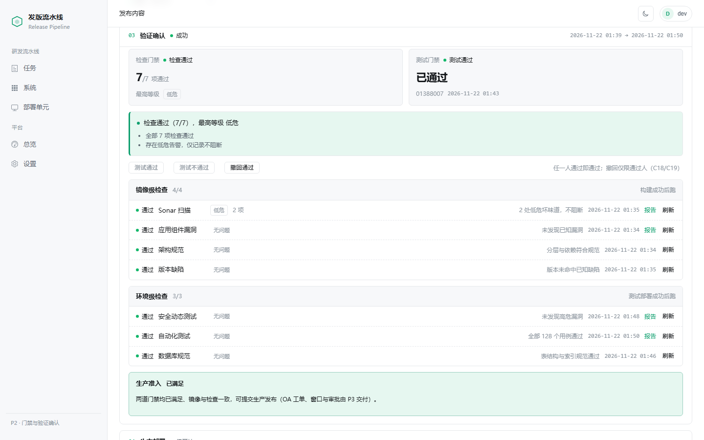
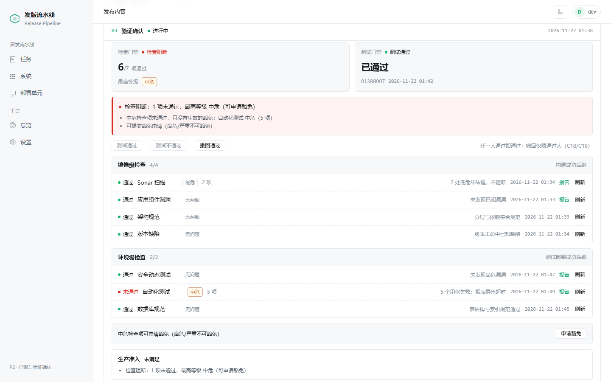

**结构（自上而下）**

1. **两道门并排**：检查门禁（`passed/total` + 最高等级 chip + 结论色点）、测试门禁（通过/未通过 +
   通过人 + 时间 + 不通过原因）。两列而不是一列，直接对应「两个维度正交」的建模（V19 拆列）。
2. **结论条**：一句话结论（`检查阻断：1 项未通过，最高等级 中危（可申请豁免）`）+ 计算过程要点，
   红/绿/强调三种底色对应阻断、通过、检查中。
3. **动作行**：`测试通过 / 测试不通过 / 撤回通过`，右侧一句话解释规则（C18/C19）。
   **不可用的动作禁用并给出原因**，不隐藏——原因优先用状态（已通过、当前不是测试中），其次用权限
   （从 `GET /api/v1/me` 读到的 `gate:test-pass` / `gate:test-revoke`）。
4. **检查明细**：按阶段分两组（镜像级 4 项 / 环境级 3 项），每行「状态点 + 名称 + 等级 chip + 问题数 +
   摘要 + 完成时间 + 报告 + 刷新」。等级用文字 chip 而不是颜色编码：高危红、中危琥珀、低危灰。
5. **豁免区**：中危且无生效豁免时给「申请豁免」；有待审批单时显示申请人/原因/到期与「批准 / 驳回」；
   到期或驳回的单据保留可见（`EXPIRED` / `REJECTED` 用红边 chip），避免「豁免去哪了」。
6. **生产准入**：`已满足` 时说明「可提交生产（P3 交付提交入口）」；未满足时逐条列出缺口
   （检查未完成 / 测试未通过 / 未产出镜像 / 检查对象与镜像不一致 / 变更项已结束）。

**交互规则**

- 任何动作成功后回到后端返回的最新面板（`POST` 返回整个 `GateView`），父页面同时刷新一次发布详情；
- 填原因的动作用 `ElMessageBox.prompt` 强制非空，原因成为留痕（`test_fail_reason` / `decide_reason`）；
- 刷新单项检查会把它重置为「执行中」，门禁随之后退成「检查中」——这正是「未完成不算通过」；
- 实例 `PAUSED` 时页头出现「恢复执行」，按钮 `title` 带出 `status_reason`，点下去若门禁未满足或
  节点尚未交付，后端拒绝并在消息里说明原因（不静默）。

## 9. CODING 对接（随 P2 之后，2026-11-22）

设置页从「说明哪里改配置」变成**能改配置**：整块「CODING 对接」放在页首，四个字段
（服务地址 / 团队 / 默认项目 / 访问凭证）+ 保存 / 测试连接。截图见
`shots/settings-light.png` / `shots/settings-dark.png`。

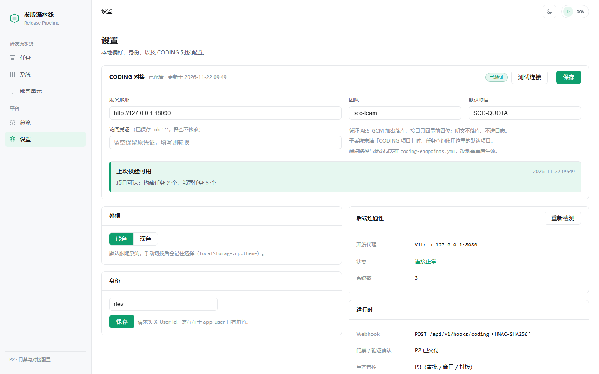
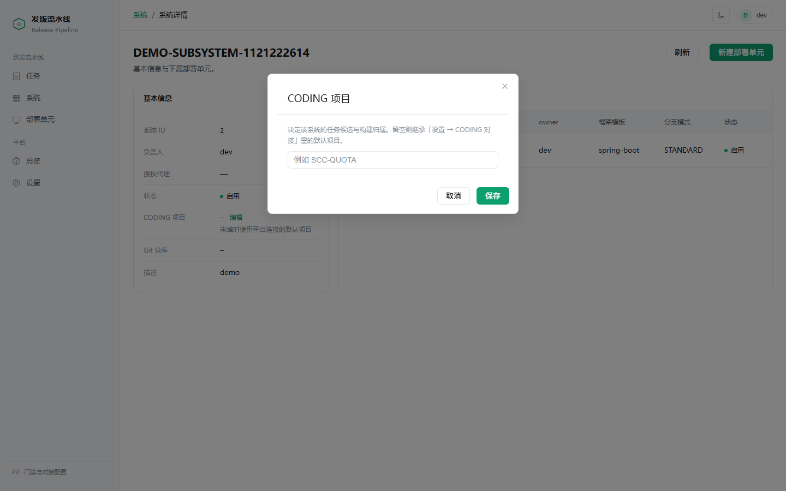

- **状态 chip**：未配置 / 已配置·未验证 / 已验证 / 上次校验失败。它来自 `last_probe_*`，
  所以「上次校验」不需要页面自己记。
- **凭证**：密码框，已配置时 placeholder 是「留空保留原凭证」，旁边写死 `tok-***`；
  页面永远拿不到明文，也不会把 `token` 回填。
- **测试连接**：结果条显示引擎原话 + 构建/部署任务数。成功时 `persisted:true` 才显示
  「已记录为上次校验结果」；改了字段再测显示「草稿测试：结果不写入配置」。
- **权限**：无 `setting:manage` 时不给表单，只给一句「需要平台管理员权限」，状态 chip 仍可见。
- 系统详情「CODING 项目」从只读改为行内「编辑」，提示「未填时使用平台连接的默认项目」。

## 10. 验收

- `npm run build` 通过，无 TS 报错；
- 明暗两套下所有页面文字对比度 ≥ WCAG AA（正文 4.5:1）；
- 后端未启动时，页面显示明确的连通性提示，不白屏；
- 任务 → 变更项 → 发布 → 发布内容 → 验证确认 的路径可完整走通（无 CODING 连接时发布结果为 FAILED，
  页面如实呈现；需要看门禁面板时用 `scripts/demo-gate.sql` 播种一次「检查已回传」的执行）。

## 11. P3 · 生产准入与生产管控（2026-11-23）

发布内容页的生产节点不再只有「提交生产发布」按钮，而是一块**生产准入**面板；侧栏新增
「生产管控」页，分「封板」「发布窗口」两个标签。截图：
`shots/release-prod-approval-light.png`（封板期双签）、`shots/release-prod-ready-light.png`
（免审待执行）、`shots/control-freezes-light.png`、`shots/control-window-light.png`，
深色对应 `-dark` 文件。

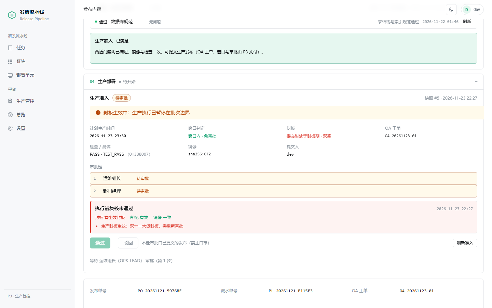


**生产准入面板（`AdmissionPanel.vue`）**

1. **状态头**：标题「生产准入」+ 状态 chip（待提交 / 待审批 / 待执行 / 生产中 / 已驳回…）+
   `快照 #id · 提交时间`。快照是提交那一刻的事实，面板不随窗口/封板变化改写它。
   整单重跑会把变更项送回「待提交」，此时最新快照属于**上一代**：头部标「（上一代 · 历史）」，
   正文整体换成「上一代快照已归档，重新提交会生成新快照」，不再把旧计划时间/封板/审批链
   当作当前证据（独立复审 B1）。
2. **快照网格**：计划生产时间、窗口判定（窗口内/外）、封板（`提交时处于封板期 · 双签` / `无`）、
   OA 工单、检查 / 测试、镜像短 sha、提交人。
3. **审批链**：`1 运维组长 待审批` → `2 部门经理 待审批` 逐行，当前待签行高亮；已签行带签批人与意见，
   驳回后未签步骤显示「已取消」。封板期即使是窗口内也必须是两步——这是设计 4.4 的双签，
   顺序要在页面上直接看出来。
4. **动作行**：`通过 / 驳回` 只对当前待签步骤开放，且需要该步骤的角色；不可用时禁用并说明原因
   （没有 `control:approve`、缺步骤角色、提交人不能自审）。驳回必须填原因。
   `执行生产发布` 在**复核未通过时直接禁用并列出原因**（封板/豁免/镜像），不再先让人点进确认框；
   生产重跑（`TESTING` + 实例停在 `PROD_DEPLOY` 的重跑）显示为 `执行生产重跑` 且可执行，
   `TESTING` 的其他情形说明「测试阶段不能执行生产」（独立复审 I1/M4）。
5. **提交入口**：`GATE_PENDING` 就给「提交生产发布」（不论是否留有上一代快照），抽屉里选计划时间 +
   填 OA 工单，可先「提交前校验」（只试算，不落库）；`REJECTED` 时给「重新提交」（新快照，旧链留史）；
   任何时刻可「刷新准入」。
6. **复核预览**：面板底部列出执行前复核的三项（封板 / 豁免 / 镜像），只说明「变了什么」，
   不重算窗口；被阻断时说明退回动作。封板提示按状态分档：`READY` 说「执行前复核会拦截」，
   `PROD_DEPLOYING` 才说「已暂停在批次边界」，`PENDING_APPROVAL` 说「需要双签」。

**生产管控页（`ControlView.vue`）**

- **封板标签**：`生效中的封板`、`待生效的封板`、`历史封板` 三段——已登记但尚未到开始时间的
  `ACTIVE` 封板在第二段列出，同样可以「解除」（独立复审 M3：误设的未来封板不能既看不到也解不了）；
  历史段显示状态与解除人/时间，最多 10 条。卡片含范围、起止、事由、影响、发起人；
  「解除」必填原因；「发起封板」抽屉（全局 / 指定系统、起止、事由、影响）。无
  `control:freeze` / `control:unfreeze` 时按钮隐藏并说明所需权限。
- **发布窗口标签**：启用窗口限制开关、星期规则（可加/删时间段；跨零点按区间判定，不拆日期归属）、
  日期例外（开放 / 关闭）、窗口试算（选时间点 → 在不在窗口内 + 下一个窗口）。保存走 `PUT /api/v1/windows`。
- 侧栏新增 `生产管控`；页脚阶段标记更新为 `P3 · 生产管控`。

**状态语义**

- 封板只拦生产：准入判定、在途转双签、执行复核；构建 / 测试 / 日常发布不受影响。
- 生产暂停（批次边界）只给「继续」一条路，继续会重跑执行前复核；通用「恢复执行」按钮对
  生产暂停**隐藏**，避免用 `/resume` 绕过复核。
- **未做**：全局封板横幅（封板状态目前只在准入面板与生产管控页呈现）；企微通知、紧急放行、
  单 DE 重试、停止发布（设计 §2 不在一期）。

**验收（P3）**

- `npm run build` 通过，无 TS 报错；`scripts/verify-p3-ui.mjs` 对发布页、封板页、窗口页断言
  选择器与文案，控制台错误为 0；
- 封板期提交后审批链出现 `运维组长 → 部门经理` 两步；两人分别通过后变「待执行」；
- 解除封板后窗口内的单自动回到「待执行」（待签步骤被收回，已签意见保留）；
- 未见浏览器控制台报错；空态（无封板 / 无快照）都有文案而不是空白。

## 12. P4-A · 回滚抽屉与发布记录（2026-11-24）

发布内容页页头新增「进入生产回滚」，抽屉按**部署单元**取版本；侧栏新增「发布记录」页
（`/records`）。截图：`shots/release-rollback-light.png` / `-dark.png`、
`shots/records-light.png` / `-dark.png`。

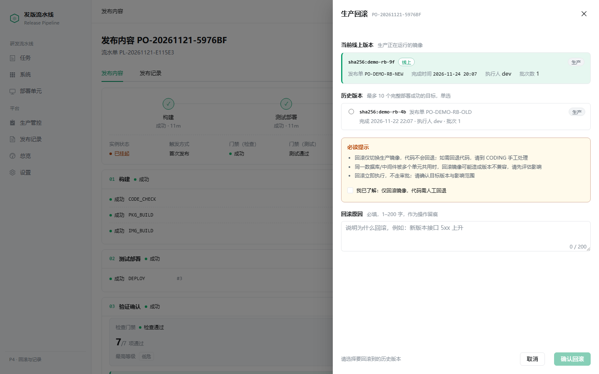
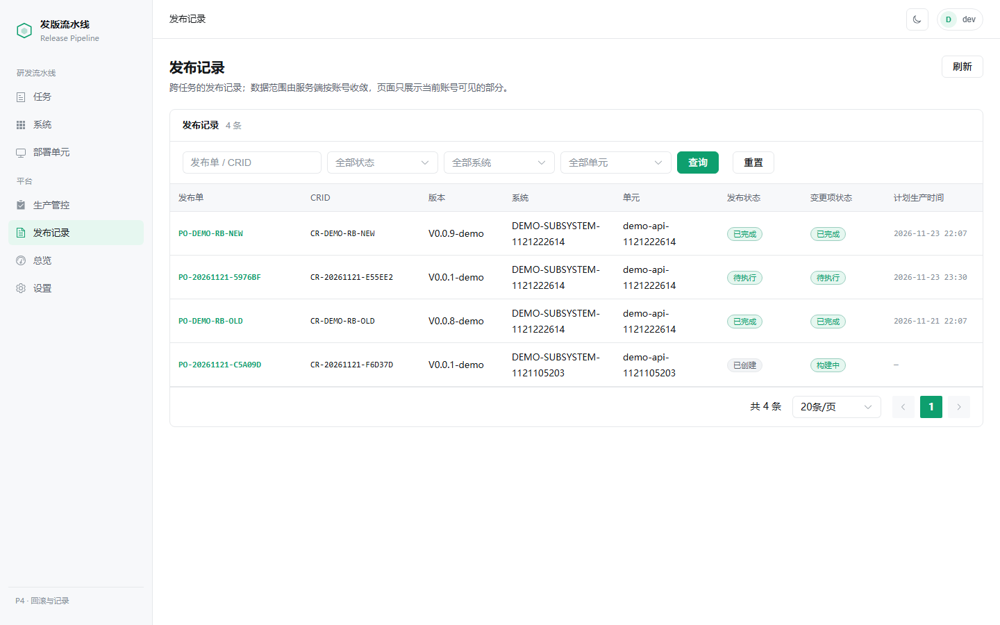

**入口与禁用原因（`ReleaseView.vue`）**

- 「进入生产回滚」常驻页头，不可用时**禁用 + 说明原因**，不隐藏（与 §8 的验证确认面板同一规则）。
  原因按顺序：`GET /api/v1/me` 未回（正在读取权限）→ 读不到身份 → 无 `rollback:execute`
  （「只有运维可以执行生产回滚（rollback:execute）」）→ 发布单未加载 → 发布单没有 `unitId`
  （后端 `980c87d` 起在详情里返回 `unitId`）。
- 抽屉入参只有 `unitId` 与 `publishNo`；成功后 `@changed` 让发布页刷新一次，发布状态与记录 Tab
  同时更新。

**抽屉结构（`RollbackDialog.vue`，640px，自上而下）**

1. **当前线上版本卡**（`.version-current`，左侧强调色边）：短 digest（保留 `sha256:` 前缀 + 前 10
   位）+「线上」chip + 环境 chip（`PROD / DR / BLUE` 的中文名）；下一行事实
   `发布单 / 完成时间 / 执行人 / 批次数`，空值显示 `—`。
2. **历史版本单选**（`.history-list`）：每行一个 radio + 短 digest + 发布单 + 环境 chip +
   `完成 · 执行人 · 批次`；最多 10 行，副标题写明「最多 10 个完整部署成功的目标，单选」。没有历史
   版本时给虚线空态「没有可回滚的历史版本：当前镜像已是唯一成功的生产版本」，不留空白。
3. **必读提示**（`.warn-box`）：服务端 `warnings` 三条原样渲染（仅镜像、共库风险、立即执行不走
   审批），下方是「我已了解：仅回滚镜像，代码需人工回退」勾选框；未勾选时确认按钮禁用并提示
   「请先勾选「我已了解」」。
4. **回滚原因**：textarea，必填、1–200 字、`show-word-limit`，placeholder 给一个示例。
5. **二次确认**：点「确认回滚」先弹 `ElMessageBox.confirm`（标题「确认回滚到历史版本」，正文带
   目标发布单、digest 与「只切换镜像，代码不会随之后退」），确认后才发 `POST /api/v1/rollbacks`。
   底部按钮常驻一行禁用原因（未选版本 / 未勾选 / 未填原因）。
6. **封板仅提示**：响应里的 `freezeWarning` 同时进 `ElMessage.warning` 与结果条；不拦提交、不改
   按钮状态。
7. **成功后**：结果条显示 `已提交回滚 #id · 流水线 <pipelineNo>` 与目标镜像，抽屉重新读一次版本
   清单（当前版本随实际结果变）；失败（40000/40001/40006/40009/40011）走 `ElMessage.error`，把
   `detail` 里的键值拼进消息。版本清单读回 40001 或发布单没有单元时，整块换成 `EmptyState`
   「该单元还没有成功的生产部署，暂不可回滚」，不当错误报。

**发布记录页（`RecordsView.vue`，路由 `/records`）**

- **筛选**（全部服务端）：关键字（发布单 / CRID）、状态（17 个状态的中文下拉）、系统、单元
  （系统变更时重拉单元选项）；`查询 / 重置 / 刷新`。
- **分页**：`page` / `size` 直传（默认 20，可选 10/20/50/100），响应
  `{total, pageNo, pageSize, records}`；旧列表的 `pageNo / pageSize` 只在 `api/index.ts` 的
  `listReleases` 一处映射（R44/R46）。
- **列**：发布单（链接到 `/releases/{publishNo}`）、CRID、版本、系统、单元、发布状态、变更项状态、
  计划生产时间、执行人、最新流水线（号 + 状态点，未执行显示「尚未执行」）、创建时间。状态文案用
  服务端下发的 `orderStatusLabel` / `itemStatusLabel`，未知值退回机器值；页面只为筛选下拉保留一份
  取值清单，不自己翻译。
- **空态**：「没有符合条件的发布记录」+「调整筛选条件，或确认当前账号的数据范围」；接口错误单独
  一条 alert，不清空已选筛选。
- **跳发布页**：发布单号本身是路由链接，列表里**不放**「回滚」按钮——回滚入口在发布页，列表行不
  知道单元上下文。

**导航与页脚（`App.vue`）**

- 侧栏在「生产管控」之后新增「发布记录」（`Document` 图标）；页脚阶段标记改为 `P4 · 回滚与记录`。

**未做（P4-A 明确不做）**

- 没有回滚记录列表页：`GET /api/v1/rollbacks` 有接口，但页面只从发布页抽屉发起回滚；`/records`
  是发布单列表，不含回滚行（R41）。
- 没有回滚进度条：回滚实例的推进看该发布单的执行记录 Tab，抽屉不轮询。
- 代码回退、按批次选择回滚、跨单元批量回滚仍是二期（设计 §1 非目标）。

**验收（P4-A）**

- `npm run build` 通过，无 TS 报错；`scripts/verify-p4-ui.mjs` 在明/暗两套下断言抽屉
  （`.rollback`、`.version-current`、`.history-list`、`.history-row`、`.warn-box`，文本含
  「当前线上版本 / 历史版本 / 仅回滚镜像 / 必读提示 / 确认回滚」）与记录页（`.filter-bar`、
  `.el-table`、行数 ≥1、`.pager`，文本含「发布单 / 变更项状态 / 最新流水线 / 计划生产时间」），
  控制台错误 0；
- 演示库（`scripts/demo-rollback.sql`，幂等、带 demo 标记）里单元 2 有两个完整前向发布：当前
  `PO-DEMO-RB-NEW`、目标 `PO-DEMO-RB-OLD`，抽屉因此至少有 1 行可选；
- 两套主题截图已入库，`-dark` 为同名文件。

## 13. P4-B · 顶栏铃铛、通知中心与消息通知设置（2026-11-24）

通知从「只有后端事件」变成可读可配：顶栏铃铛（未读徽标 + 最近 5 条下拉）、`/notifications`
通知中心、设置页「消息通知」块。截图：`shots/notifications-light.png` / `-dark.png`、
`shots/settings-notify-light.png` / `-dark.png`。

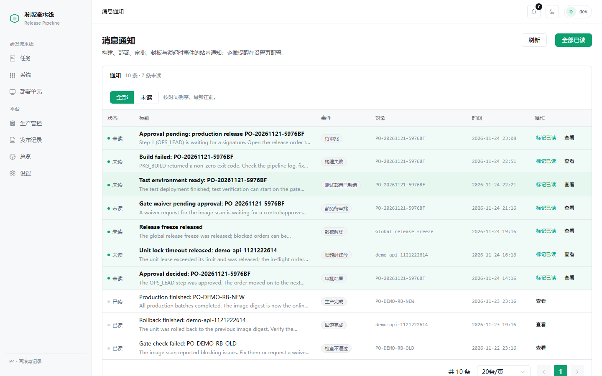
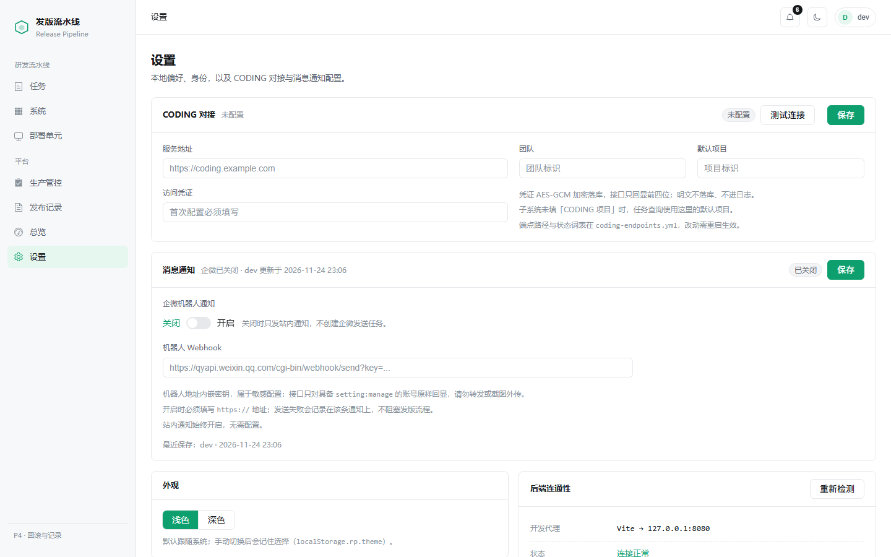

**顶栏铃铛（`App.vue`）**

- 铃铛常驻顶栏（`.notify-bell`），徽标 `.notify-badge` 只在 `unread > 0` 时出现；显示 `99+`
  封顶（`unreadBadge`），`0` 不显示。`aria-label` 带未读条数，开合状态在 `aria-expanded`。
- 未读数来源 `GET /api/v1/notifications/unread-count`；进入页面（`onMounted`）、每次路由切换
  （`route.fullPath` watch）、以及通知中心标记已读后的共享 revision（`notificationRevision`）
  都会立即刷新；另有 30s 轮询，组件卸载时清掉定时器。轮询失败静默（下一轮再试），不打扰业务页面。
- 点铃铛开下拉：每次打开重新取最近 5 条（`GET /notifications?page=1&size=5`），面板头显示
  「消息通知」+「N 条未读 / 全部已读」，行内是事件中文名（服务端 `eventLabel`）+ 时间；未读行
  加粗并有强调色圆点；空态是「暂无通知」。加载中 `el-skeleton`，失败 `el-alert`，不白屏。
- 点外部关闭（`document` 监听，面板内点击不关闭）；「查看全部」跳 `/notifications`。
- 点单条：未读则先 `POST /notifications/{id}/read`，徽标本地减一（`Math.max(0, unread-1)`），
  再按 `objectType` 跳转；标记失败不拦跳转（阅读优先，通知中心仍显示未读可重试）。跳转规则
  收敛在 `web/src/utils/notification.ts#notificationTarget`：
  - `ORDER` → `/releases/{objectId}`；`ITEM` → `/releases/{objectLabel || objectId}`（当前没有
    ITEM 行，先兜底）；`UNIT` → `/units/{objectId}`；`FREEZE` → `/control`；
  - `WAIVER` → `/releases/{objectLabel}#gate`；`objectLabel` 正常是发布单号，服务端在没有发布单时
    退回 CRID（此时链接可能指向不存在的发布单）；未知类型返回 `null`，停在原页不误跳。

**通知中心（`NotificationsView.vue`，路由 `/notifications`）**

- 页头 `PageHeader`（标题「消息通知」，描述列出构建/部署/审批/封板/锁超时来源），动作「刷新」与
  「全部已读」（无未读时禁用）。
- 筛选「全部 / 未读」走服务端 `unreadOnly`，不是在当前页里过滤；切换筛选或每页条数回到第 1 页。
  副标题「N 条 · M 条未读」，`M` 是接口给的本人未读总数。
- 表格列：状态（未读/已读 + 圆点）、标题（标题 + 一行正文摘要）、事件（`eventLabel` chip）、对象
  （`objectLabel || objectId`）、时间、操作（「标记已读」只在未读行出现、「查看」在不可跳时禁用）。
  未读行用 `--accent-weak` 低对比底色，不引入新色板。
- 分页 `page`/`size` 直传，默认 20，可选 10/20/50/100；`total` 来自服务端。
- 单条「标记已读」成功后本地减一，并 bump 共享 revision 让铃铛立即刷新；在「未读」筛选下该行
  随即从列表移除（重新取当前页）。
  「全部已读」先 `ElMessageBox.confirm`（正文带未读条数），成功后 `ElMessage.success('已标记 N 条为已读')`
  并刷新列表与徽标。
- 点击行 = 先标已读再按同一跳转规则导航（与铃铛共用 `notificationTarget`）。
- 空态：全部→「还没有通知」，未读→「没有未读通知」，提示「构建、部署、审批、封板与锁超时事件
  会出现在这里」；接口失败给独立 `el-alert`，不清空已选筛选（保留可重试状态）。

**设置页「消息通知」块（`SettingsView.vue`）**

- 位置在「CODING 对接」之后，`DataSection` 标题「消息通知」；状态 chip：读取中 / 只读 / 默认关闭 /
  已开启 / 已关闭。副标题带最近保存人与时间。
- 有 `setting:manage` 时：企微开关（开启/关闭，说明「关闭时只发站内通知，不创建企微发送任务」）、
  机器人 Webhook 输入框、保存按钮。保存后回显服务端返回的 `updatedBy`/`updatedAt`；开关打开而
  地址为空时前端先给警告，不白跑一次请求。
- 无权限时整块只读：不调用 `GET /settings/notifications`（避免必然的 40009 console error），只显示
  「需要平台管理员权限」与原因；页面自己读 `GET /me` 判断权限，不蹭 CODING 块的 `canManage`
  （两者加载时序不同，会闪只读态）。
- 敏感提示：机器人地址内嵌密钥，接口只对 `setting:manage` 原样回显；「请勿转发或截图外传」写在
  输入框下方；同时说明 `https://` 要求与「发送失败记录在该条通知上，不阻塞发版流程」。

**导航**

- `/notifications` 的入口是铃铛下拉的「查看全部」与直接 URL；侧栏未新增导航项（通知是顶栏常驻
  入口，避免与「发布记录」等并列挤占一级导航）。

**验收（P4-B）**

- `cd web; npm run build` 通过（`vue-tsc -b` + vite，无 TS 报错）。
- `scripts/verify-p4b-ui.mjs` 在明/暗两套下断言：徽标数 >0、下拉 5 行、`/notifications` 行数 ≥1、
  未读筛选生效、单条标记已读后徽标减一、设置块可编辑、只读账号显示只读态；控制台错误 0：

  ```
  notifications-light: badge=7 dropdown=5 rows=10 unreadRows=7 markRead=7->6 settings=ok readonly=ok total="10 条 · 7 条未读" errors=0
  notifications-dark: badge=6 dropdown=5 rows=10 unreadRows=6 markRead=6->5 settings=ok readonly=ok total="10 条 · 6 条未读" errors=0
  OK all notification assertions passed
  ```

  探针每套主题会消耗一条未读，重跑前先重新应用 `scripts/demo-notify.sql`（幂等，插入 10 条
  `INAPP` / `recipient='dev'`、7 条未读，带 `DEMO-NTF-` 标记）。
- 补充人工路径（不属提交的探针）：豁免行 → `/releases/PO-20261121-5976BF#gate` 且徽标 5→4；
  发布单行 → `/releases/PO-20261121-5976BF`；「标记已读」留在 `/notifications` 且徽标 5→4。
- 截图由探针生成并入库；实现者无法读图，正确性以 DOM 文案/选择器/计算样式与包围盒断言为准。
- 下拉面板 360×421 px（1440×900 视口），右缘与铃铛对齐，无横向溢出。

**未做（P4-B 明确不做）**

- 侧栏没有「消息通知」一级导航；`/notifications` 只能从铃铛或 URL 进入。
- 通知中心只有「全部 / 未读」：没有关键字、事件类型、对象类型筛选，没有单条详情页，没有删除/归档。
- `FREEZE` 行一律跳 `/control`，不带封板 id 或定位；`WAIVER` 行在没有发布单号时（`objectLabel`
  退回 CRID）会跳到不存在的发布单路径；`ITEM` 行当前不产生。
- 没有浏览器桌面通知/声音/标题闪烁；没有按用户订阅偏好、@人、模板管理；没有邮件/飞书（只留后端接口）。
- 企微发送失败行不在通知中心展示（接口只返回站内行），页面上看不到失败原因，要查 `notification` 表/日志。
- 未读数靠 30s 轮询 + 路由切换 + 同页 revision，不是推送；多实例后端的徽标最多滞后一个轮询周期。
- 页脚阶段标记仍是 `P4 · 回滚与记录`（本轮未改 `App.vue` 的页脚文案）。

## 14. P4-C · 单元操作日志与全局审计页（2026-11-25）

审计从「只有 `log.info`」变成可查、可筛、可导出：单元详情多一个通栏「操作日志」块，侧栏「平台」组
多一个 `/audit` 审计页。截图：`shots/audit-{light,dark}.png`、`shots/unit-audit-{light,dark}.png`
（1440×900，探针 `scripts/verify-p4c-ui.mjs --shots` 生成，`git add -f`）。

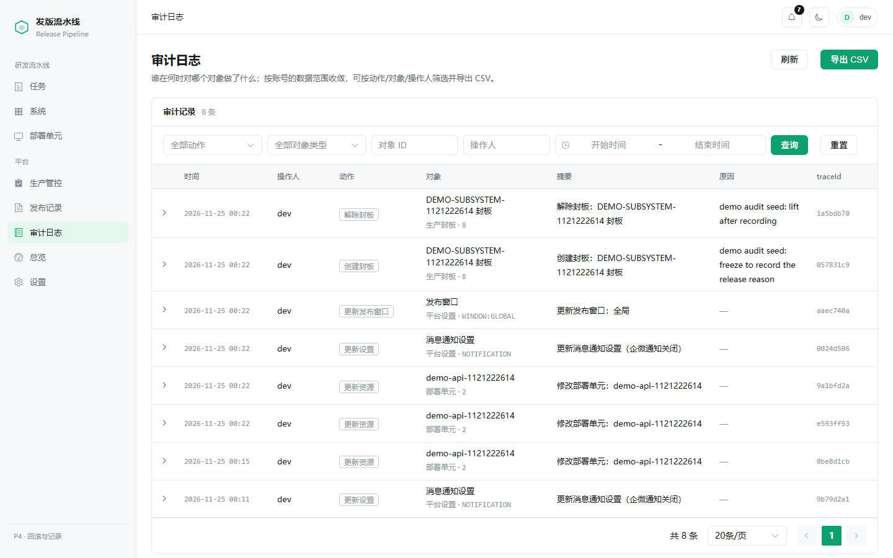
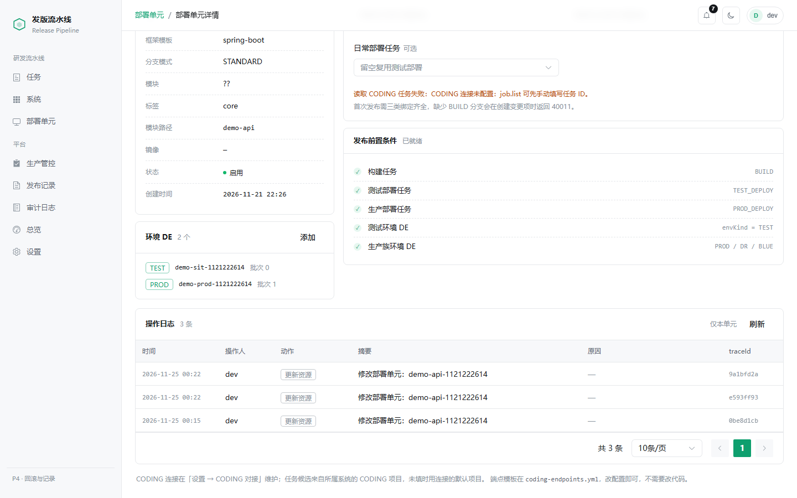

**单元详情「操作日志」（`UnitDetailView.vue`）**

- 位置：在两栏概览（左：基本信息 / 环境 DE，右：CODING 绑定 / 发布前置条件）之后、页脚之前，通栏
  `DataSection`，标题「操作日志」、副标题「N 条」、右上「仅本单元」+「刷新」。**不用 Tab**：把现有
  两栏概览塞进 `el-tabs` 会打断页面信息流，而 6 列表格放进约 570px 的右栏必然横向滚动；通栏后
  1170px 内无横向滚动（实测 `bodyScrollW == bodyClientW`），与发布记录页的表格观感一致。
- 数据：`listAudit({ unitId: id, page, size })`，服务端按 `unitId` 过滤（`scope_unit_id = ?`），
  单元内的发布/审批/门禁/封板/回滚/资源修改都会落到这里；默认 10 行/页，可选 10/20/50。
- 列：时间（`formatDateTime`）、操作人、动作（`actionLabel` chip，hover `title` 是机器码）、摘要、
  原因（空显示 `—`）、traceId（前 8 位，hover `title` 全量）。**不展示 before/after**（列太多）。
- 状态：加载 `el-skeleton`；失败独立 `el-alert`（不清空分页/筛选）；空态「尚无操作日志」，提示
  「发布、门禁、封板、回滚与本单元的配置变更都会记录在这里」；页头「刷新」同时刷新概览与日志。
- 越界/无范围：服务端回空页，页面显示空态而不是报错（审计不暴露单元是否存在）。

**全局审计页（`AuditView.vue`，路由 `/audit`）**

- 页头 `PageHeader`（标题「审计日志」，描述「谁在何时对哪个对象做了什么；按账号的数据范围收敛…」），
  动作「刷新」「导出 CSV」。
- 筛选栏（`DataSection` 顶部）：动作下拉（13 个常用动作，分「发布与审批 / 门禁与管控 / 配置与资源」
  三组，首项「全部动作」且 `clearable`）、对象类型（9 个封闭值 + 全部）、对象 ID、操作人、时间范围
  （`datetimerange`）、「查询」「重置」。`objectId` / `actor` 是**精确匹配**，占位文案按此写；
  动作/对象类型/时间范围是服务端筛选，查询回到第 1 页。
- 表格列：时间、操作人、动作、对象（`objectLabel || objectId` + 中文类型 + 机器 id）、摘要、原因、
  traceId；首列展开行显示「变更前 / 变更后」两块 `<pre>`（`prettyJson`），null 分别显示
  「无（新增对象）」「无（删除对象）」。全局页用展开行而不是加列：`before/after` 是 JSON 文本，
  展开比横向铺开更省宽度。
- 分页：默认 20，可选 10/20/50/100，`total` 来自服务端；`pageNo`/`pageSize` 是响应口径（R44）。
- 导出：`fetch` 拿 blob 再 `<a download>`（**不用 `window.open`**，会丢 `X-User-Id`）；文件名取
  `Content-Disposition` 的 `audit-*.csv`，回退 `audit-<时间戳>.csv`；沿用**当前筛选**、不带分页；
  成功 `ElMessage.success`，失败 `ElMessage.error`（导出失败仍是 JSON 信封，由 `exportAudit` 转
  `ApiError`）。
- 空态：`NO-SUCH-OBJECT` 之类查不到 → 「没有符合条件的审计记录」+「调整筛选条件，或确认当前账号的
  数据范围」；空结果不报错。页脚说明「最多 5000 行；`before/after` 只保存变化的字段，展开行可见
  前后对比，不是整行快照」。
- 亮/暗双主题沿用石墨令牌；筛选项与展开行不引入新色板。

**导航**

- 路由 `/audit`（`router.ts`，`meta.title/crumb = 审计日志`）；侧栏「平台」组新增「审计日志」
  （`Memo` 图标），位于「发布记录」之后、「总览」之前。页脚阶段标记仍是 `P4 · 回滚与记录`（本轮未改）。

**验收（P4-C）**

- `cd web; npm run build` 通过（`vue-tsc -b` + vite，无 TS 诊断）。
- `scripts/verify-p4c-ui.mjs`（复制到 `%TEMP%\rp-shot-tools` 后运行，两主题，0 console error）：单元页
  「操作日志」标题 + 6 列表头 + ≥1 行 + traceId 短 8 位且 `title` 更长；侧栏 `a[href="/audit"]` 文案；
  `/audit` 7 列表头 + ≥1 行 + traceId；动作筛选（总数变少且每行是该动作，chip 的 `title` 是机器码）；
  重置回全量；对象类型筛选同形；展开行出现「变更前/变更后」；导出响应 200 + `text/csv` +
  `Content-Disposition` 的 `audit-*.csv` + 成功 toast + 请求携带当前 `objectType` 且无 `page`/`size`；
  空态；两主题各自 0 console error。原样输出：

  ```
  audit-light: unitRows=3 unitTrace=9a1bfd2a auditRows=8 total=8 actionFilter=3/3 objectFilter=3/3 export=200 text/csv;charset=UTF-8 attachment; filename="audit-20261125-003238.csv" errors=0
  audit-dark: unitRows=3 unitTrace=9a1bfd2a auditRows=8 total=8 actionFilter=3/3 objectFilter=3/3 export=200 text/csv;charset=UTF-8 attachment; filename="audit-20261125-003244.csv" errors=0
  OK all audit assertions passed
  ```

- 截图由探针生成并入库（4 张）；实现者无法读图，正确性以 DOM 文案/选择器/计算样式与包围盒断言为准。
- 探针数据是 live 后端上的真实动作（`PUT /units/2` ×3、通知设置、窗口、封板 create+release）；仓库
  没有 `scripts/demo-audit.sql`（简报点名的文件不存在，未新建），重建库后按上述 5 条重放即可。

**未做（P4-C 明确不做）**

- **时间范围未进探针断言**：控件与 `from`/`to` 已接（后端有 `from > to` 的 40000），但 Element Plus
  双月面板的确定性点击成本高；探针覆盖动作/对象类型/对象 ID（空态）三条筛选路径与导出，日期范围
  只做了手工验证（面板可开、0 console error）。
- 动作下拉不是全量枚举：只列 13 个常用动作，未列动作（`GATE_TEST_FAIL`、`WAIVER_*`、
  `FREEZE_EXPIRE`、P5 占位等）仍可通过「全部动作」检索到并显示服务端中文名；对象类型 9 个必须在
  `utils/audit.ts` 镜像（行里没有 `objectTypeLabel`），改枚举时两处要同步。
- 没有字段级 diff 高亮、没有审计告警、没有保留期/清理入口（P7）；单元页没有展开行（严格 6 列），
  before/after 只在全局页看；没有按 `traceId` 串联请求的视图。
- 导出是同步的 5000 行上限，没有导出预览、后台导出任务，**导出动作本身也不写审计行**（读操作不留痕）。
- 页脚阶段标记未更新；没有对象/动作详情页。

## 15. P5-A · 日常发布入口、记录与详情（2026-11-25）

日常发布从「没有创建路径」变成任务详情里的一等操作：变更项行多「日常」「记录」两个动作，表下多一个
「日常发布」通栏 `DataSection`，记录行打开 600px 详情抽屉；**不新增路由、不加全局导航**。截图：
`shots/daily-{light,dark}.png`（1440×900，探针在 DONE 记录上打开抽屉，`git add -f`）。

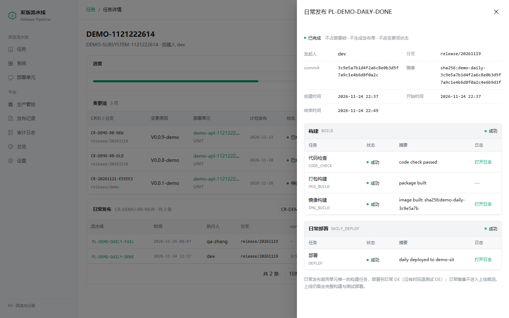
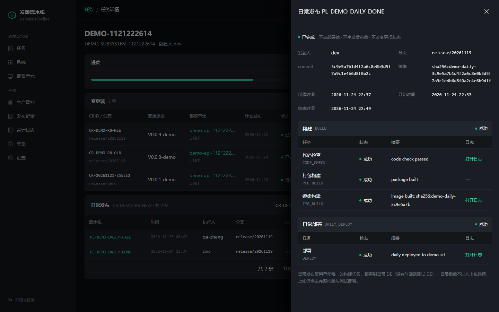

**变更项行「日常」与确认框（`TaskDetailView.vue`）**

- 位置：任务详情「变更项」表格每行的操作列，`发布` 之后是 `日常` 与 `记录`；`row.type === 'LIB'` 的行
  **不渲染**这两个动作（日常只支持 `UNIT`，服务端也会以 40001 拒绝）。
- 权限：`GET /api/v1/me` 的 `perms` 含 `release:daily` 才可点。缺失时按钮 `disabled`，并用**原生
  `title`** 写明「当前账号缺少 release:daily 权限，无法发起日常发布」——`el-button` 禁用时 Element Plus
  的 tooltip 不触发，原生 title 既可见又能被探针断言。可点时的 title 是「发起日常发布（不占锁、不改变更项
  状态）」。**不隐藏历史**：无权限只置灰按钮，记录块仍可读（读接口只要登录 + 单元范围）。
- 点击 → `ElMessageBox.confirm`，标题「日常发布确认」，正文点名变更项与边界：
  「确认对「<单元> / <版本>」发起日常发布？日常发布不占锁（不占用部署单元锁）、不改变更项状态、不生成
  发布单，可与在线发布并行；目标环境优先使用该单元的日常 DE，没有日常 DE 时回退到测试 DE。」
  确认按钮「发起日常发布」、取消「取消」。取消不产生任何实例（探针专门断言这一点）。
- 确认后 `startDaily(item.id)`：成功 `ElMessage.success('已发起日常发布 <pipelineNo>')`，记录块切到该变更项
  并刷新到第 1 页；失败显示 `ApiError.message`（例如 40001「任务已归档」），按钮 loading 状态按行隔离。
- 「记录」按钮不下发请求：把记录块的变更项切到该行并 `scrollIntoView`，用于从长表格直接跳到记录。

**日常记录块（`DataSection`，任务详情左栏、变更项表下方）**

- 标题「日常发布」，副标题 `<crid> · 共 N 条`；右上：仅当任务有多个 `UNIT` 变更项时出现变更项选择器
  （label 为 `<crid> · <version>`），以及「刷新」。
- 列（7 列）：流水线（mono 链接）、时间（`formatDateTime`）、执行人（空显示 `—`）、分支（mono + `title`
  全文，空 `—`）、commit（`shortSha`，前 10 位，hover 全文）、结果（`StatusDot`，node 域）、日志。
- 「日志」列只有「查看」：**记录列表接口只返回实例行，不含逐任务 `externalUrl`**，所以这里不伪造外链；
  点「查看」或整行打开详情抽屉，逐任务日志链接在抽屉里。另加「流水线」列便于定位（列表接口没有单号搜索）。
- 数据：`listDaily(itemId, page, size)`；默认 10 行/页，可选 10/20/50，`total` 来自服务端；换页/换页大小
  回到服务端重取（`page`/`size` 是后端自己的分页名）。加载用 `el-skeleton`；失败独立 `el-alert`（不清空
  当前列表）；空态「还没有日常发布记录」，提示「点击变更项行的「日常」发起；日常不占部署锁、不改变更项
  状态，可并行多次。」。
- 为什么不做表格行展开、不另开页面：变更项维度本来就在这一页，一块记录 + 选择器即可到达任一变更项的
  历史；再开一页会把「当前任务的上下文」丢掉，也会和在线发布页抢同一套路由语义。

**详情抽屉（`el-drawer`，600px）**

- 标题「日常发布 <pipelineNo>」；头部 `StatusDot` + 边界说明「不占部署锁 · 不生成发布单 · 不改变更项
  状态」。
- 元信息 `KeyValue` 七项：发起人、分支、commit、镜像、创建时间、开始时间、结束时间。
- 每个节点一段：中文名（`statusLabel(nodeType)`：构建 / 日常部署）+ 机器码 + 节点状态，下面任务表 4 列：
  任务（中文名 + 机器码）、状态、摘要（空 `—`，hover 全文）、日志（`externalUrl` 存在时是
  `<a target="_blank" rel="noopener noreferrer">打开日志</a>`，否则 `—`）。
- 页脚固定说明：「日常发布复用单元唯一的构建任务，部署到日常 DE（没有时回退测试 DE）；日常镜像不进入
  上线候选，上线仍需走完整构建与测试部署。」——对应 J4，避免把日常成功读成可上线。
- 状态：加载 `el-skeleton`、失败独立 `el-alert`；关闭抽屉不清列表。

**为什么用抽屉而不是 `/daily/:pipelineNo` 路由**

- 日常发布不是发布单（没有 `release_order`），它的详情是某个变更项的一次执行，挂在任务详情下最自然；
  抽屉保留「正在看哪个任务/哪些变更项」的上下文，也不必为它新增面包屑、刷新与返回语义。
- 设计 §6 允许「详情抽屉或页面」二选一；选抽屉后**没有直达链接**，但记录列表（按变更项 + 分页）已经
  覆盖可达性，代价可接受。若后续要分享单次日常执行，再加路由即可，接口无需变化。

**验收（P5-A）**

- `cd web; npm run build` 通过（`vue-tsc -b` + vite，无 TS 诊断，无新增依赖）。
- `scripts/verify-p5a-ui.mjs`（复制到 `%TEMP%\rp-shot-tools` 后运行，双主题，0 console error）：
  1. `dev` 的 `CR-DEMO-RB-NEW` 行「日常」可点、title 含「不占锁」、同行「记录」存在；点击后确认框含
     「日常发布确认 / 不占锁 / 不改变更项状态 / 不生成发布单 / 并行 / V0.0.9-demo」，取消后不产生实例。
  2. 记录块副标题含 `CR-DEMO-RB-NEW` 与「共 2 条」；7 列表头齐全；两条种子行 `PL-DEMO-DAILY-DONE`（已完成、
     `dev`、commit `3c9e5a7b1d`）与 `PL-DEMO-DAILY-FAIL`（失败、`qa-zhang`）。
  3. 打开 DONE 行抽屉：标题含单号、2 个节点（构建 / 日常部署）、任务标签（代码检查/打包构建/镜像构建/部署）、
     分支 `release/20261119`、commit 前 10 位、「不占部署锁」说明、≥3 个 `https://` + `target=_blank` 的
     「打开日志」链接。
  4. 切 `ops-lead`（localStorage `rp.userId`）后同一按钮 `disabled`，title 含 `release:daily`；两主题各
     0 console error。
- 探针原文（复制自 `task-2-report.md`，与截图同批次）：

  ```
  daily-light: rows=2 done=yes fail=yes nodes=2 links=3 denied=true errors=0
  daily-dark: rows=2 done=yes fail=yes nodes=2 links=3 denied=true errors=0
  OK all daily assertions passed
  ```

- 数据：`scripts/demo-daily.sql`（ASCII-only、幂等）为 item 6 造两条 `PL-DEMO-DAILY-*` 记录；只读
  `release_item` / `env_de`，先删后插自己的两行，不改 `env_de`、binding、发布单与变更项状态。item 2 保留
  一条真实 API 发起的 `PL-20261124-FC1762`（`ENGINE_UNAVAILABLE` 预期失败）。
- 截图由探针生成并入库（2 张）；实现者无法读图，正确性以 DOM 文案/选择器/属性断言为准。

**未做（P5-A 明确不做）**

- **记录列表没有逐任务日志链接**：列表接口只回实例行；「日志」列是「查看详情」的入口，真正的
  `externalUrl` 在抽屉里（见上）。
- **不在接口/按钮旁返回目标环境命中情况**：设计 §6 允许「接口返回或按钮旁提示」，实现两者都未做；
  确认框只有固定文案「优先日常 DE，回退测试 DE」。
- 没有全局「日常发布」页、没有 `/daily/:pipelineNo` 路由、没有侧栏入口；日常记录只在任务详情里。
- 没有按状态/执行人/分支/时间筛选，也没有日志下载；只有按变更项 + 分页。
- 没有停止/重试/取消日常（GAP-05）、没有日常通知（只写审计）、没有日常镜像入库/一致性校验。
- 探针数据来自种子 + live 后端，**没有真实 CODING 成功路径的界面证据**（本机无连接，真实记录是
  `ENGINE_UNAVAILABLE` 失败）；截图未做人眼复核。

## 16. P5-B · 停止 / 退出 / 关闭 / 归档（2026-11-25）

四个止损动作首次有页面入口：发布内容页页头两扇门（停止 / 退出）、任务详情变更项行「关闭」、页头「归档任务」
与归档后的只读态；四处确认共用一个新组件 `ReasonDialog.vue`（必填原因 1–200）。**不新增路由、不加导航**。
截图（1440×900，探针生成，`git add -f` 入库）：

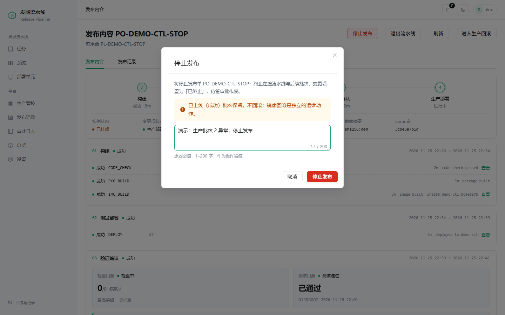
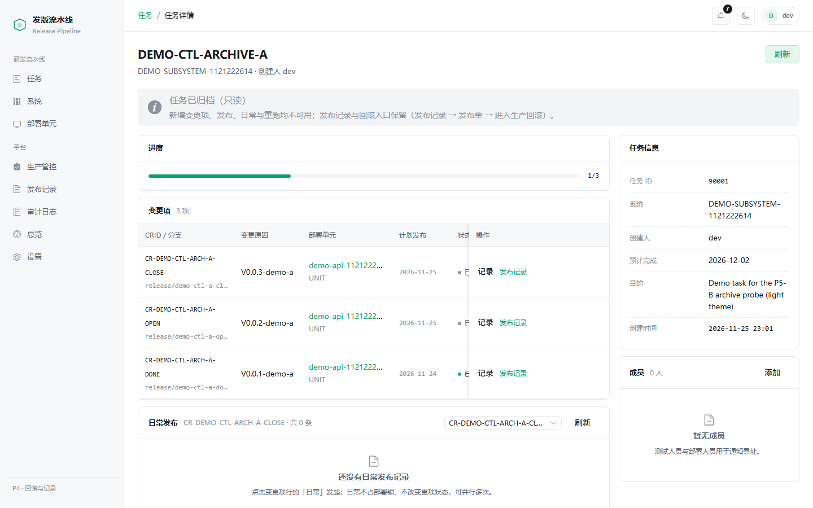

**共享确认框 `web/src/components/ReasonDialog.vue`（新组件）**

- `el-dialog` 520px，`close-on-click-modal=false`；`el-input type=textarea :rows=3 maxlength=200 show-word-limit`；
  标题、`message`（级联说明）、`warning`（不可逆部分，`el-alert` warning 块）、`confirmText`、`placeholder`、
  `danger`（停止/归档用红色确认按钮，退出/关闭用 primary）、`busy` 由父组件控制。
- 校验：trim 后 1–200 才能确认；空/超长/请求中确认按钮 `disabled`，请求中显示 loading；底部提示固定
  「原因必填，1–200 字，作为操作留痕」，超长变红「原因不能超过 200 字」。
- 每次打开清空原因（上一次「停止」的理由不会带进下一次「退出」）；**服务端拒绝时保留已输入文字**，由父组件
  决定是否关闭，便于改正后重试。

**发布内容页 `web/src/views/ReleaseView.vue`（页头两扇门）**

- 位置：`PageHeader` 右侧，`停止发布`（class `stop-release`）在 `退出流水线`（class `exit-release`）之前。
- 禁用口径全部落在**变更项状态**上（`GET /api/v1/releases/{publishNo}/admission` 的 `itemStatus`），不用实例
  状态：实例 `PAUSED` 时变更项仍是 `PROD_DEPLOYING`，用实例状态会把「暂停等待」误判成「不可停止」。读取失败/
  未加载时按钮也禁用，`title` 说明原因。
  - 停止：需要 `control:execute-prod`；状态 ∈ 生产流程四态（`isStoppableItemStatus`：`SUBMITTED`/
    `PENDING_APPROVAL`/`READY`/`PROD_DEPLOYING`）。可用时 title「终止在途生产流水线；已上线批次保留，不回滚」；
    不可用时 title 点名缺权限或当前状态「不在生产流程中，请使用退出流水线」。
  - 退出：需要 `release:publish` **或** `control:execute-prod`；状态不是「不可再退出」集合
    （`isTerminalItemStatus`：`DONE`/`CLOSED`/`TERMINATED`/`ROLLED_BACK`）。可用时 title
    「退出任意非终态流水线，作废待签审批与未完成检查」。
- 两个确认框文案（停止）：message「将停止发布单 <单号>：终止在途流水线与后续批次，变更项置为「已终止」，
  待签审批作废。」；warning「已上线（成功）批次保留，不回滚；镜像回滚是独立的运维动作。」。退出：message
  「…终止在途实例，变更项置为「已终止」，未完成检查置为失效，待签审批作废。」；warning「已上线批次保留；
  退出后该发布单不可恢复执行，如需回退请使用生产回滚。」。
- 提交 `stopRelease`/`exitRelease`：成功后 toast「已停止发布：变更项 已终止[，已终止实例 <单号>]；已上线批次保留」/
  「已退出流水线：变更项 已终止…」，关闭对话框并 `load()` 刷新整个发布页（状态、节点、记录）。
- **40001 专门处理**：对话框关闭、显示服务端句子（例如「变更项状态已变化，操作未生效，请刷新后重试」），
  并重读 `admission`/详情——不把旧状态留在页面上。其他错误直接显示 `ApiError.message`（40009 原文含缺的权限点）。
- 按钮加载态由页面级 `controlBusy` 控制，两个按钮互斥，防重复提交。

**任务详情 `web/src/views/TaskDetailView.vue`（行内关闭 + 归档 + 只读态）**

- 变更项行操作列：`发布` 之后新增 `关闭`（class `close-item`，`type=danger` link）。条件：任务未归档、
  有 `release:publish`、行状态不在 `isTerminalItemStatus`（`DONE` 与三个闭合终态）；不可用时 `disabled` +
  原生 `title`（缺权限 / 「当前状态「X」不可关闭」）。确认框 message 点名
  「<crid> · <单元> / <版本>」，warning「关闭后该变更项不可再发布；活动实例终止，待签审批与未完成检查作废；
  发布记录保留。」；成功后 toast `已关闭变更项「<crid>」（已关闭）[，已终止实例 <单号>]` 并刷新列表。
- 页头「归档任务」（class `archive-task`，`type=danger plain`）：`task:create` **且**（创建人是当前用户 **或**
  当前用户有 `ADMIN` 角色）；任务已归档时按钮**不渲染**。不可用时 `disabled` + `title` 点名缺权限 / 非创建人 /
  已归档。
- 归档确认框的**级联预览**：message「将归档任务「<任务>」：级联关闭 <N> 个未完成变更项[，正在统计在途实例… |
  ，终止 <M> 个在途实例]。」，N = 列表里 `!isTerminalItemStatus` 的行数，M = 打开对话框后**客户端**从
  `GET /api/v1/releases?unitId=…` 的发布记录里数出的未完成项最新实例数（`archiveInFlight`，请求中显示「正在统计」）。
  warning「归档后任务只读：新增变更项、发布、日常与重跑均不可用；发布记录与回滚入口保留。此操作不可撤销。」。
  确认 `archiveTask` → toast 用**响应**的 `closedItems/terminatedInstances`：
  「任务已归档：关闭 N 个变更项，终止 M 个在途实例；发布记录与回滚入口保留」。
- 归档后的只读态：页头 `新建变更项`/`归档任务` 不再出现；顶部 `el-alert`「任务已归档（只读）」+「新增变更项、
  发布、日常与重跑均不可用；发布记录与回滚入口保留（发布记录 → 发布单 → 进入生产回滚）。」；行内
  `发布`/`关闭`/`日常` 消失，`记录`（日常记录，仅 `UNIT` 行）与 `发布记录` 保留；`发布记录` 链到
  `/records?keyword=<crid>`（发布记录页 → 发布单 → 生产回滚入口）。

**发布记录页 `web/src/views/RecordsView.vue`**

- 只加一处：读取 `?keyword=` 作为初始筛选（归档任务行的「发布记录」链接落点），不新增页面/接口。

**API / 类型 / 状态集合**

- `web/src/api/index.ts`：`stopRelease(publishNo, reason)`、`exitRelease(publishNo, reason)`、
  `closeItem(itemId, reason)`、`archiveTask(taskId, reason)`，都是 POST `{reason}`。
- `web/src/api/types.ts`：`ControlResult {status?, itemStatus, terminatedPipelineNo?}`、
  `ArchiveResult {taskStatus, closedItems, terminatedInstances}`（与 §12.2.8 响应一致）。
- `web/src/utils/format.ts`：`isTerminalItemStatus`（`DONE`/`CLOSED`/`TERMINATED`/`ROLLED_BACK`）、
  `isStoppableItemStatus`（生产流程四态）、`ARCHIVED → 已归档` 标签。

**演示数据 `scripts/demo-control.sql`（新脚本，幂等、ASCII-only）**

- 造 `PO-DEMO-CTL-STOP`：变更项 `PROD_DEPLOYING`、实例 `PAUSED` at `PROD_DEPLOY`、批次 1 `SUCCESS` + 批次 2
  `PENDING`、单元锁在；`DEMO-CTL-ARCHIVE-A/-B` 两个任务各 DONE + TESTING/RUNNING + GATE_PENDING（一个任务给
  一个主题，归档不可逆，重跑探针前重放脚本）。只删自己标记的行（children first），不碰 `PO-20261121-5976BF`。
- 给 `ops-lead` 幂等 `INSERT IGNORE` 一个 `OPS` 角色：live 种子只有 `OPS_LEAD`，而探针需要一个
  `control:execute-prod` 且无 `release:publish` 的身份（C20 保证 OPS 永不持 `release:publish`）；不改角色表。

**验收（P5-B）**

- `cd web; npm run build` 通过（`vue-tsc -b && vite build`，`✓ built in 1.87s`，1671 modules，无新依赖）。
- `scripts/verify-p5b-ui.mjs`（复制到 `%TEMP%\rp-shot-tools` 后运行，双主题，0 console error），探针原文：

  ```
  p5b-light: task=90001 stop=on exit=on ops=stop/exit dept=blocked closed=yes archived=yes rows=3 errors=0
  p5b-dark: task=90002 stop=on exit=on ops=stop/exit dept=blocked closed=yes archived=yes rows=3 errors=0
  OK all stop/exit/close/archive assertions passed
  ```

  每主题断言：开发看到两扇门可点、停止 title 含「已上线批次保留，不回滚」；两个确认框的级联文案、空原因禁用
  确认、`maxlength=200` 与 `/200` 计数、输入后可确认、取消不改变发布单；`ops-lead`（只有
  `control:execute-prod`）可停止**且**可退出；`dept-manager`（两者皆无）两扇门禁用且 title 点名缺权限；
  `ops-lead` 的 `关闭`/`归档任务` 禁用；开发真实关闭一条 GATE_PENDING 行后行变「已关闭」；归档对话框显示
  「关闭 1 个未完成变更项，终止 1 个在途实例」，确认后只读态出现、创建/归档按钮消失、行内发布/关闭/日常/重跑
  消失、DONE 行保留、每行保留 `?keyword=` 的发布记录链接；两主题 0 console error。
- **真实 stop 证据**（种子 + live 后端，随后重放脚本恢复演示态）：
  `POST /api/v1/releases/PO-DEMO-CTL-STOP/stop`（dev，理由
  `demo control stop evidence: production batch 2 unhealthy`）→
  `{"code":0,"data":{"status":"TERMINATED","itemStatus":"TERMINATED","terminatedPipelineNo":"PL-DEMO-CTL-STOP"}}`；
  DB 断言：实例 `TERMINATED` + `status_reason` + `end_at`；`PROD_DEPLOY` 节点 `RUNNING→SKIPPED`，批次 1
  `SUCCESS` 保留、批次 2 `SKIPPED`（summary「已取消：<reason>」）；`release_item`/`release_order` 均
  `TERMINATED`；`deploy_unit_lock` 该实例 0 行；审计行 `actor=dev action=STOP object=PO-DEMO-CTL-STOP`、
  `reason` 原文、`after_json` 含 `itemStatus/instanceStatus/terminatedPipelineNo`。
- 截图 4 张入库（探针生成，未人眼复核）：`release-stop-{light,dark}.png`、`task-archived-{light,dark}.png`。
  探针**会真的关闭/归档**一条种子数据（每主题一个任务），重跑前必须重放 `scripts/demo-control.sql`。

**与设计不一致（前端，代码为准）**

1. **归档预览的 N 与后端 `closedItems` 口径不同**：前端 N 用 `isTerminalItemStatus`（排除 `DONE`/`CLOSED`/
   `TERMINATED`/`ROLLED_BACK`），仍会计入 `GATE_FAILED`/`FAILED`/`REJECTED`；后端级联用
   `ItemStatus.isBlocking()` 会跳过这三类。种子/演示里若存在 GATE_FAILED 项，预览 N 可能大于响应
   `closedItems`；toast 一律以响应为准（见 §8.11 偏差 3）。
2. **「M 个在途实例」是客户端统计**：没有新增后端预览端点，页面从 `GET /api/v1/releases?unitId=` 的未完成项
   最新实例状态里数；`archiveInFlight` 只用于文案，权威计数仍是归档响应。
3. **停止按钮只看变更项状态**：`GET .../admission` 的 `itemStatus`（PAUSED 实例仍显示 `PROD_DEPLOYING`）；
   设计 §6 没有规定用哪个状态，这里刻意不用实例状态。
4. **退出按钮的权限口径与后端 OR 一致**，但页面对「C20 角色」没有额外提示：OPS/OPS_LEAD 永无
   `release:publish`，仍可因 `control:execute-prod` 退出；关闭按钮对它们始终禁用（C20 在拦截器就拒）。
5. **40001 的恢复动作是页面自定的**：关对话框 + 服务端原文 + 重读状态；设计只说「成功后刷新」。
6. **归档后保留的两个入口**是「记录」（日常记录）与「发布记录」（`/records?keyword=`）；`RecordsView` 因此
   新增 `?keyword=` 读取——设计 §6 只说「保留发布记录入口」，没有给落点。
7. **没有停止/退出的影响面预览**（批次清单、实例号、审批人名单），也没有节点级「停止」入口；停止/退出只在
   发布页页头，关闭/归档只在任务详情。
8. **演示脚本改了 live 身份**：给 `ops-lead` 幂等加 `OPS` 角色（环境种子与简报不符）；不改角色/权限表。

**未做（P5-B 明确不做）**

- 不做**已上线批次回收**：停止只终止后续批次，页面与 toast 都写明「已上线批次保留」；镜像回滚是 P4-A 的独立入口。
- 不做**归档撤销/批量归档**：归档不可撤销，一次一个任务；没有「归档后仍可编辑」的临时态。
- 不做**停止/退出的行内或节点级入口**、不做「停止并回滚」组合动作。
- 不做**归档前的服务端预览**：N/M 都是客户端估算，响应才权威。
- 没有停止/退出/关闭/归档的**前端单测**；覆盖靠 `scripts/verify-p5b-ui.mjs` 的 DOM 断言（无 CI 浏览器）。
- 截图未人眼复核（实现模型无图像输入）；探针数据来自种子 + live 后端，**没有真实 CODING 引擎取消的界面证据**
  （本机无连接）。

## 17. P5-C · 待办中心（2026-11-25）

待办从「无入口」变成侧栏一等入口：`/todos` 页四段队列 + 侧栏徽标，页面只渲染服务端算好的
`label/statusLabel/waitingHours/link`，**不做二次过滤、不拼路由**。不新增依赖、不新增后端端点。
截图（1440×900，探针生成，`git add -f`）：

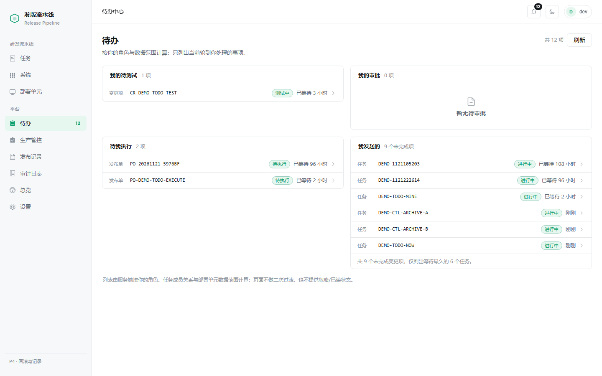
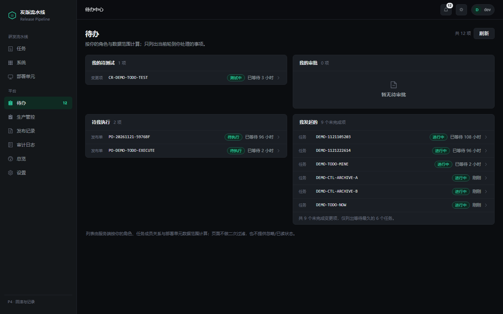

> 交付时间线：本轮文档动笔时前端提交 `feat: P5-C web todos` 尚不存在；写到中途由另一实现者提交为
> `c805568`（9 个文件，含 2 张截图）。以下事实按该提交的代码复核（此前 `/todos` 没有任何实现，现已不是
> 「未核实」状态）。

**侧栏「待办」与徽标（`web/src/App.vue`）**

- 「平台」分组内新增 `/todos` 导航项（图标 `List`），徽标 = 四组 `count` 之和；`0` 隐藏、`>99` 显示 `99+`。
- 刷新：`onMounted` 立即取一次 + 30s 定时（与通知铃铛同款），并在路由变化时再取一次；`onUnmounted` 清理
  定时器。徽标请求 `listTodos(1)`（只要 count），失败**保留上一次的数字**、下一个 tick 重试（侧栏装饰不弹错）。
- 可访问性：有数字时 `aria-label="待办，N 项"`，徽标 `aria-hidden`。

**`/todos` 页（`web/src/views/TodoView.vue`）**

- 页头 `PageHeader`：标题「待办」，说明「按你的角色与数据范围计算；只列出当前轮到你处理的事项。」；右侧
  「共 N 项」（四组 count 之和）+「刷新」（loading）。
- 四段 `DataSection`（两列 grid，≤1100px 收单列）：`我的待测试 / 我的审批 / 待我执行 / 我发起的`。段标题
  副标题：前三段「N 项」，`mine` 段「N 个未完成项」（服务端 count 是未完成变更项数，不是任务行数）。
- 行（`todo-row` grid 5 列）：对象类型中文（`ITEM→变更项`/`ORDER→发布单`/`TASK→任务`，未知回退原值）、
  `label`（mono，省略号 + title 全文）、状态 chip（`statusLabel || status`，色调用 `statusTone`）、等待文案、
  右箭头。整行是 `RouterLink`（服务端 `link` 原样绑定），`link` 为空时退化为静态 `div` 且不显示箭头。
- 截断：`count > items.length` 时段落底部说明——前三段「共 N 项，仅显示等待最久的 M 项。」，`mine` 段
  「共 N 个未完成变更项，仅列出等待最久的 M 个任务。」。
- 空态：单段空 → `EmptyState`（暂无待测试/暂无待审批/暂无待执行/暂无我发起的任务）；四段全空 → 整页
  `EmptyState`「当前没有待办」。加载骨架 `el-skeleton`；失败独立 `el-alert`（保留旧列表）。
- 页脚固定说明：「列表由服务端按你的角色、任务成员关系与部署单元数据范围计算；页面不做二次过滤，也不提供
  忽略/已读状态。」。

**等待文案与跳转**

- `waitingHours <= 0` →「刚刚」，否则「已等待 N 小时」（只到整点，不做天换算）；hover `title`
  「自 YYYY-MM-DD HH:mm 起等待」（`formatDateTime`，本地时区）。
- `link` 由服务端给，页面原样绑定为 `RouterLink`：`/tasks/{taskId}?item={itemId}`（变更项）、
  `/releases/{publishNo}`（发布单）、`/tasks/{taskId}`（任务）；`link` 为空时行不可点。

**API / 类型 / 路由**

- `web/src/api/index.ts#listTodos(limit = 5)` → `GET /api/v1/todos?limit=N`。
- `web/src/api/types.ts`：`TodoItemView`（9 字段，`waitingHours` 也是字符串）、`TodoGroupView {count,items}`、
  `TodoBoardView {test,approval,execute,mine}`。
- `web/src/router.ts`：`/todos`（`title: '待办'`、`crumb: '待办中心'`）。

**演示数据 `scripts/demo-todos.sql`（新脚本，幂等、ASCII-only）**

- 四组各造一条确定性数据：`test` = task 90003 `DEMO-TODO-TEST`（TESTING、测试未通过，最新实例
  `test_ready_at=now-3h`，dev 为 TEST 成员，实例**故意 PAUSED** 使 reconcile 不推进、等待时长稳定）；
  `execute` = `PO-DEMO-TODO-EXECUTE`（READY，2h 前）；`approval` = `PO-DEMO-TODO-APPROVAL-A`（第 1 步
  OPS_LEAD、第 2 步 DEPT_MANAGER，5h）与 `-B`（第 1 步 DEPT_MANAGER，2h），提交人都是 dev；
  `mine` = task 90005 `DEMO-TODO-MINE`（2h 前）与 90007 `DEMO-TODO-NOW`（now →「刚刚」），均由 dev 创建且有
  一个 PENDING 项。
- 幂等身份：dev / ops-lead / dept-manager（角色 + ALL 范围）+ `demo-bot`（ACTIVE、无角色、无范围）。`demo-bot`
  是测试/执行/审批演示任务的 creator，既不污染真实身份的「我发起的」，又用来验证四组全 0 的整页空态。
- 只删自己标记的行（children first）；跑探针前重放一次（「刚刚」行相对种子时间）。演示数据落在
  subsystem 2 / unit 2；未改 `demo-control.sql`。

**验收（P5-C）**

- `cd web; npm run build` 通过（`vue-tsc -b && vite build`，`✓ 1674 modules transformed`，`✓ built in 1.11s`，
  无新依赖）。
- `scripts/verify-p5c-ui.mjs`（复制到 `%TEMP%\rp-shot-tools` 后运行，双主题，0 console error），探针原文：

  ```
  p5c-light: dev=1/0/2/9 badge=12 itemLink=yes orderLink=yes emptySegment=yes | ops=0/1/2/0 badge=3 approvalA=yes empty=yes | dept=0/1/0/0 badge=1 approvalB=yes noApprovalA=yes | empty=demo-bot pageEmpty=yes badge=none | errors=0
  p5c-dark: dev=1/0/2/9 badge=12 itemLink=yes orderLink=yes emptySegment=yes | ops=0/1/2/0 badge=3 approvalA=yes empty=yes | dept=0/1/0/0 badge=1 approvalB=yes noApprovalA=yes | empty=demo-bot pageEmpty=yes badge=none | errors=0
  OK all todo-centre assertions passed
  ```

  断言：四段标题/顺序与每段 count；徽标 = 四组 count 之和并与页首「共 N 项」一致；等待文案（3 小时/2 小时/
  刚刚）；行 href 与服务端 `link` 一致并**真实点击跳转**（`/tasks/90003?item=90031`、
  `/releases/PO-DEMO-TODO-EXECUTE`）；空段轻量空态；dept-manager 看不到第 1 步是 OPS_LEAD 的 APPROVAL-A
  （只显示最低待签步骤）；`demo-bot` 四组全 0 的整页空态且无徽标；两主题 0 console error。
- 布局实测 1440×900：`scrollHeight=900`、`scrollWidth=1440`，四段在首屏内（grid bottom 644）。
- 截图 2 张入库（dev 视角，四段/徽标/等待文案/空段可见；未人眼复核）。

**与设计不一致（前端，代码为准）**

1. **页面请求 `limit=20`（接口上限），不是设计的默认 5**：待办中心按真实队列展示；`count` 仍是全量，截断时
   段落底部明说「仅显示等待最久的 M 项」；侧栏徽标请求 `limit=1`（只用 count）。
2. **`mine` 段的计数文案与另三段不同**：服务端 `count` 是未完成变更项数、行是任务，页面写「N 个未完成项」/
   「仅列出等待最久的 M 个任务」，避免把 count 读成任务数（技术方案 §8.12 偏差 2）。
3. **第四个演示身份 `demo-bot`**：设计只列 dev/ops-lead/dept-manager，三者没有任何一个四组全空；为验证
   「四段全空 → 整页空态」与服务端 fail-closed 增加该身份，同时充当演示任务 creator。
4. **等待文案只到小时、0 显示「刚刚」**：设计 §3 只写「已等待 N 小时」；没有分钟/天换算（旧数据会出现
   「已等待 108 小时」），绝对时间放在 hover title。
5. **四段是两列 grid（≤1100px 单列）**：设计只说四段 `DataSection`，未规定布局；为 1440×900 截图一屏呈现。
6. **整页空态是设计之外的补充**：设计只要求「空段轻量空态」，实现另加四段全空时的整页 `EmptyState`。
7. **状态 chip 的颜色复用 `statusTone(status)`**：chip 文案用服务端 `statusLabel`（缺省回退 `status`），
   颜色不由服务端给。
8. **没有已读/忽略/折叠/筛选/分页**：与设计 §5 一致（二期）；截断只给说明，没有「加载更多」。

**未做（P5-C 明确不做）**

- 没有已读/忽略/关闭待办、没有历史/已办列表、没有筛选/搜索/分页（只有服务端 `limit` 与截断说明）。
- 没有服务端推送：徽标 30s 轮询 + 路由刷新。
- 没有天级等待文案、没有按组折叠。
- 没有前端单测；覆盖靠 `scripts/verify-p5c-ui.mjs` 的 DOM 断言（无 CI 浏览器）。
- 截图未人眼复核（实现模型无图像输入）；探针数据来自种子 + live 后端，**没有真实审批/测试操作后的界面证据**
  （只验证队列呈现与跳转）。

---

## 18. P6-A · 二方库制品与发布（2026-11-26）

二方库从「单元可建、发布被拒」变成一条独立的三节点发布路径：单元详情多出「制品坐标 / 依赖单元」，发布页
只显示 `构建 → 安全检测 → 入库`、隐藏全部生产语义，创建/编辑单元时坐标必填。**不新增路由、不新增导航、
不新增依赖**；`web/src/utils/artifact.ts` 是后端坐标规则在前端的镜像。

截图（1440×900，探针生成，`git add -f`）：

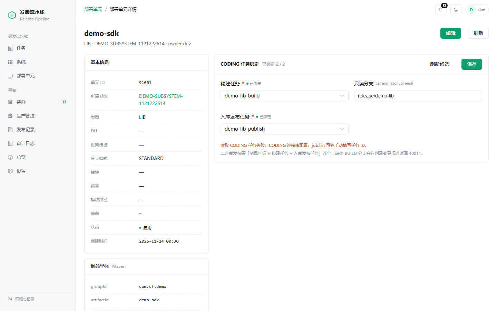
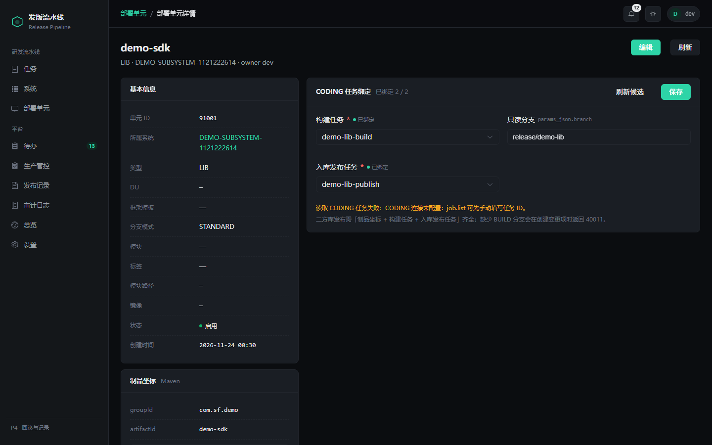
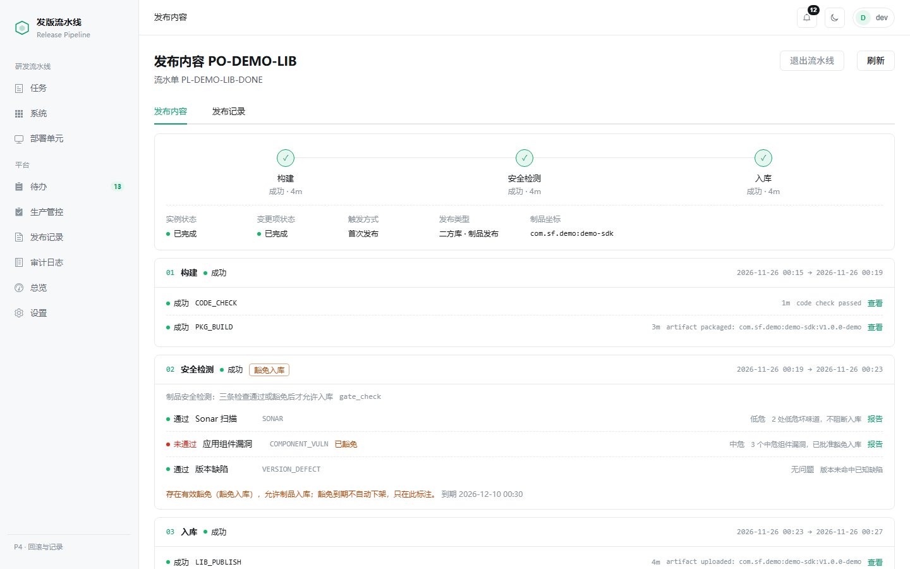
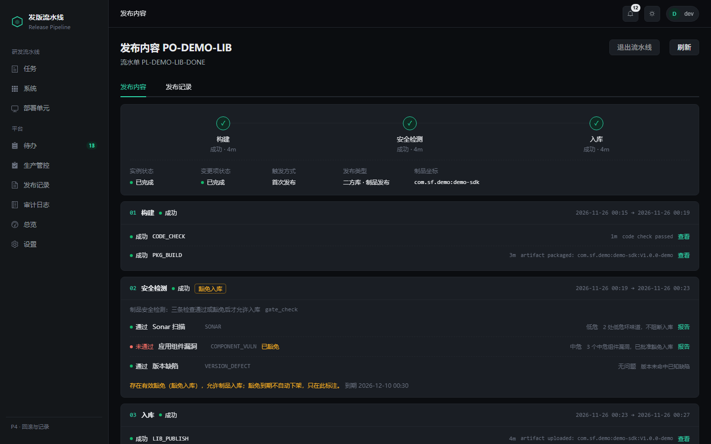

**单元详情 · LIB 分支（`web/src/views/UnitDetailView.vue`）**

- `isLib = unit.type === 'LIB'`。只有 LIB 才请求 `GET /api/v1/libs/{id}/dependents`（UNIT 不请求、不显示两块）。
- 「制品坐标」`DataSection`（副标题 `Maven`）：`groupId`/`artifactId` 两个 `KeyValue`、一行 mono
  `com.sf.group:artifact`、说明「发布时版本取自变更项的 version；本阶段不接私服，只记录坐标与入库结果」。
- 「依赖单元」`DataSection`（副标题「N 个」）：来源说明「依赖来源 `MODULE_PATH`：启发式，同系统内 module_path
  等于制品 artifactId 的部署单元；接口能力确定后替换实现不改契约」；表格两列——单元名（`router-link` 到
  `/units/{unitId}`）、`modulePath`（mono，空显示 `—`）；无行时 `EmptyState`「暂无依赖单元」，加载时骨架，
  请求失败显示 `lib-error` 文案且不阻塞页面其余部分。
- LIB **隐藏**「环境 DE」与「发布前置条件」两块（库没有部署环境/测试与生产 DE）；「CODING 任务绑定」收窄为
  `BUILD` + `LIB_PUBLISH` 两类（摘要「已绑定 N / 2」），隐藏 `TEST_DEPLOY`/`PROD_DEPLOY`/`DAILY_DEPLOY`，并在
  说明里写「二方库只有构建与制品上传（LIB_PUBLISH）两类绑定」与「制品坐标 + 构建任务 + 入库发布任务齐全」。
- 编辑对话框：`type=LIB` 时显示两个必填输入（`maxlength=128`，占位 `com.sf.demo`/`demo-sdk`），提示
  「二方库必须填写制品坐标；groupId 与 artifactId 分别匹配 仅字母、数字、点、下划线、连字符，1-128 位」；
  切回 UNIT 立即隐藏并清空输入，保存时 UNIT 不发送这两个字段（服务端落 `NULL`）。

**发布内容页 · LIB 分支（`web/src/views/ReleaseView.vue`）**

- 识别：`unitType === 'LIB'` **或** 节点里出现 `LIB_SECURITY`/`LIB_PUBLISH`（后者保证 unit 接口失败时页面仍是
  LIB 形态）。只有 LIB 才额外读 `GET /units/{id}`（坐标）与 `GET /items/{id}/gate`（三条检查），两者都
  best-effort，失败不挡主页面。
- `StepBar` 三节点：`构建`/`安全检测`/`入库`；摘要区多「发布类型 二方库 · 制品发布」「制品坐标
  com.sf.group:artifact」，**隐藏**「门禁（检查）」「门禁（测试）」「镜像摘要」「commit」。
- `LIB_SECURITY` 节点只渲染 `SONAR`/`COMPONENT_VULN`/`VERSION_DEFECT` 三条 `gate_check`（从 `getItemGate` 的
  分组里按 `kind` 过滤，不显示另外四项）：每行状态点 + 中文名 + `kind` + 等级 + `summary` + 报告外链；头文案
  「制品安全检测：三条检查通过或豁免后才允许入库」；无行时 `EmptyState`「安全检查尚未回传」。
- 豁免标记：后端 `GateCheckStatus` 没有 `WAIVED`，豁免是「检查 FAIL + 有效豁免 → 聚合结论 `WAIVED`」，所以
  `libWaived = libGate.conclusion === 'WAIVED'`（不是只看 `waiver.active`，避免过期/不匹配快照误报）。
  满足时 `LIB_SECURITY` 标题旁显示 el-tag「豁免入库」（title 带到期时间），节点内显示「存在有效豁免（豁免入库），
  允许制品入库；豁免到期不自动下架，只在此标注。到期 …」，被豁免的 FAIL 行加「已豁免」。
- 隐藏（生产专用）：「停止发布」「进入生产回滚」、`AdmissionPanel`（生产准入）、`VerifyPanel`（验证/测试门禁）、
  门禁与测试人员、镜像/commit、重跑起点/全量重跑；保留「退出流水线」「刷新」「发布记录」Tab。页脚文案：
  「二方库流水线：构建（CODE_CHECK → PKG_BUILD，不产镜像）→ 安全检测（SONAR / 组件漏洞 / 版本缺陷）→
  入库（制品上传）。不进入生产准入，也没有测试部署、生产部署与回滚。」
- 发布记录 Tab 照常列实例：演示数据给出 `PL-DEMO-LIB-DONE`（已完成）与 `PL-DEMO-LIB-FAIL`（失败）两行；
  取证时真实 live 记录的实例是 `FAILED`（BUILD 的 `ENGINE_UNAVAILABLE`），页面按实例状态显示。

**创建/编辑单元表单（`web/src/views/SubsystemDetailView.vue`）**

- 「新建部署单元」对话框的 `type` 下拉含 `LIB`（`二方库`）；选中后出现「制品 groupId」「制品 artifactId」两个
  必填项 + 格式提示，UNIT 下完全不出现；切回 UNIT 清空已输入坐标。
- 前端先拦：空值提示 `制品 groupId必填（二方库）`（第二字段同理），非法格式提示
  `制品 groupId格式不合法：仅字母、数字、点、下划线、连字符，1-128 位`；对话框不关闭、不发请求。
- `web/src/utils/artifact.ts`：`ARTIFACT_COORDINATE_MAX=128`、`ARTIFACT_COORDINATE_RE=/^[A-Za-z0-9._-]{1,128}$/`、
  `ARTIFACT_COORDINATE_HINT`、`isArtifactCoordinate`、`artifactCoordinateError`；与后端
  `UnitAppService` 的规则逐字一致，**前端拦截不替代后端 40000 校验**。

**API / 类型**

- `web/src/api/index.ts#getLibDependents(unitId)` → `GET /api/v1/libs/{unitId}/dependents`；
  创建/更新单元请求体加可选 `artifactGroupId`/`artifactArtifactId`。
- `web/src/api/types.ts`：`UnitView` 加两个可空字段；新增 `LibDependentView {unitId,name,modulePath}`、
  `LibDependentsView {libUnitId,artifactId,source,dependents}`。
- `publishItem` 的返回类型仍是 `{publishNo,pipelineNo}`（后端多了 `type`，页面不依赖它，LIB 形态由单元/节点判断）。

**演示数据与探针**

- `scripts/demo-lib.sql`：LIB 单元 91001（`com.sf.demo:demo-sdk`）、同系统 UNIT 91002
  `demo-sdk-consumer`（`module_path=demo-sdk`，让启发式非空）、一条 LIB 任务/变更项/发布单
  `PO-DEMO-LIB`、两条实例 `PL-DEMO-LIB-FAIL`（BUILD 失败）与 `PL-DEMO-LIB-DONE`（三检查 + 一条豁免 + 入库成功）、
  `CR-DEMO-LIB-LIVE`（供真实发布取证）；固定 ID/CRID，幂等，只删自己的行。
- `scripts/verify-p6a-ui.mjs`（从 `scripts/` 拷到 `%TEMP%\rp-shot-tools` 执行，双主题）：
  LIB 单元坐标/依赖块（`MODULE_PATH`/`启发式`/1 行/链接 `/units/91002`）、无环境 DE/发布前置条件；UNIT 回归
  （无两块、编辑框无坐标、原样保存后类型与坐标不变）；LIB 发布页三节点/三条检查/「豁免入库」/到期文案/
  无生产准入与验证面板/无停止与回滚；发布记录两行 DONE/FAILED；创建表单 UNIT 隐藏坐标、LIB 两个必填、空值与
  非法格式均被拦；0 console error。

**验收（P6-A）**

- `cd web; npm run build`（`vue-tsc -b && vite build`）通过：`✓ built in 981ms`（无新依赖）。
- 探针原文（双主题）：

  ```
  p6a-light: libUnit coords=com.sf.demo:demo-sdk dependentRows=1 source=MODULE_PATH unitRegression=yes steps=构建/安全检测/入库 checks=3 waiver=豁免入库 noProdPanels=true records=2 createGuard=blank+badFormat errors=0
  p6a-dark: libUnit coords=com.sf.demo:demo-sdk dependentRows=1 source=MODULE_PATH unitRegression=yes steps=构建/安全检测/入库 checks=3 waiver=豁免入库 noProdPanels=true records=2 createGuard=blank+badFormat errors=0
  OK all second-party library assertions passed
  ```

- 真实接口：`POST /api/v1/items/91002/publish`（`X-User-Id: dev`）返回
  `{"publishNo":"PO-20261125-036E37","pipelineNo":"PL-20261125-A5D696","type":"LIB"}`；实例 `90044` 在 BUILD 以
  `ENGINE_UNAVAILABLE: CODING 连接未配置：build.start` 失败，`LIB_SECURITY`/`LIB_PUBLISH` `PENDING`；单元锁
  `unit 91001`、审计 `PUBLISH`；按设计 LIB 不发通知。抓取时 `release_order.status=INIT`（`ef87f0f` 之前），
  修复后监听器把变更项状态镜像到发布单（测试断言 `DONE`/`FAILED`）；该 live 数据已由 `demo-lib.sql` 恢复。
- 截图 4 张入库；**未人眼复核**（实现模型无图像输入）。

**与设计不一致（前端，代码为准）**

1. **创建表单在 `SubsystemDetailView.vue`，不是 `UnitListView.vue`**：后者只有列表、没有创建/编辑对话框；
   坐标字段落在「新建部署单元」与单元详情「编辑部署单元」两处，UNIT 两处都不显示。
2. **LIB 的 CODING 绑定面板是设计之外的补充**：设计只说 LIB 无部署/环境配置，但后端 `assertPublishable` 要求
   `LIB_PUBLISH` 绑定；不补这个选择器，页面无法为 LIB 配齐发布条件。面板只显示 `BUILD` + `LIB_PUBLISH`。
3. **LIB 隐藏「环境 DE」与「发布前置条件」**：两块对库没有意义；UNIT 原样保留（探针断言）。
4. **发布页额外隐藏「停止发布」「进入生产回滚」、测试门禁/镜像/commit/重跑信息**：设计只要求隐藏生产准入与
   测试人员；这些同属生产语义，保留会误导。保留「退出流水线」。
5. **`WAIVED` 不是检查状态**：`gate_check.status` 仍是 `FAIL`，页面以 `ItemGate.conclusion === 'WAIVED'` 显示
   「豁免入库」，并在 FAIL 行标「已豁免」；只看 `waiver.active` 会把过期/不匹配快照误报为已豁免。
6. **`isLib` 的两路判断**：除单元类型外，节点里出现 LIB 节点即按 LIB 渲染；`publishItem` 类型声明不包含后端新增的
   `type`（页面不依赖它）。这是有意的降级，避免单元接口失败时整页回退成 UNIT 形态。
7. **探针的 UNIT 回归会真实保存一次 UNIT 2**（原值回写），每次运行产生一条 `RESOURCE_UPDATE` 审计；不影响 LIB
   页面与截图。
8. **演示数据多造一个 UNIT** `demo-sdk-consumer`：否则依赖启发式在种子环境里恒为空，无法验证非空表格与链接；
   脚本幂等且只删自己的固定行，不改既有 demo 单。
9. **依赖块在加载完成前显示占位来源**：`libInfo?.source ?? 'MODULE_PATH'`，失败时只显示错误文案；接口契约中的
   `source` 仍以服务端为准。

**未做（P6-A 明确不做）**

- **没有制品详情/下载链接**：不接私服（Q4），页面只显示坐标与入库任务结果。
- **没有版本规则**：版本取自变更项，页面不自动递增/校验重复。
- **没有依赖 API**：依赖仍是 `module_path` 启发式，页面上明确标注。
- **没有 LIB 通知/待办/回滚/日常入口**：库不进入生产准入，也没有测试部署与生产部署。
- **没有前端单测**：覆盖靠 `scripts/verify-p6a-ui.mjs`；探针的 LIB 成功/失败数据来自种子，**不是真实上传成功后的
  界面证据**（真实 live 只到 BUILD 失败）。
- **截图未人眼复核**；端到端成功路径（`publish.start` 真正返回）未在本机验证。

## 19. P6-B · 平台设置三段（2026-11-26）

> **编号与补写说明**：本节是 P6-C §20 编号说明里预留的 P6-B 页面章节。前端 `9a13915` 早已合并，文档于本次
> 补写；P6-C 正文与台账 R90–R98 未改动。接口与后端口径见技术方案 §8.14 / §12.2.11，残留见未实现清单 GAP-08。

设置页在「消息通知」之后多出三块：**门禁规则 / 审批人名单 / 锁超时**。`web/src/views/SettingsView.vue`
新增 3 个 `DataSection`、6 个 API 函数（`web/src/api/index.ts`）与 3 个响应类型（`web/src/api/types.ts`）；**不新增
路由、不新增导航、不新增依赖**。无 `setting:manage` 时三块只读且**连 GET 都不发**。

截图（1440×900，探针生成，`git add -f`；两张都是**已恢复默认值**的状态——7 项全开 / 空名单 / 168）：

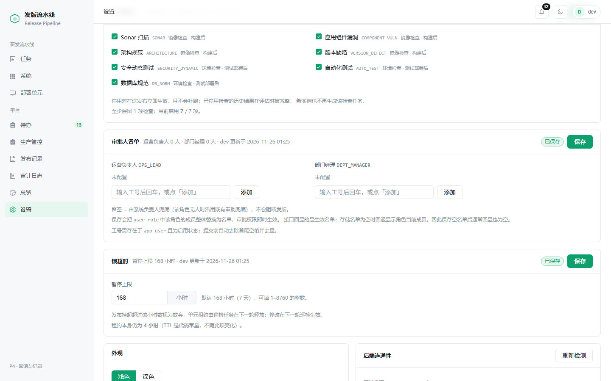
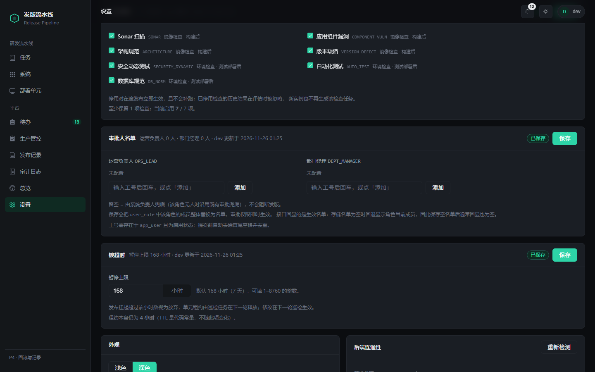

**块位置与结构（`SettingsView.vue`）**

- 三块依次在「消息通知」`DataSection` 之后：`.settings-gate`（标题「门禁规则」）、`.settings-approvers`
  （「审批人名单」）、`.settings-lock`（「锁超时」）；每块 `#actions` 是状态 `chip`（`读取中…` / `默认…` /
  `已保存` / `只读`）+「保存」按钮（无权限不渲染，保存中 loading/disabled）。
- 副标题随状态变化：门禁「N / 7 项启用 · {user} 更新于 …」或「… · 默认配置」；审批人「运营负责人 X 人 ·
  部门经理 Y 人」；锁「暂停上限 X 小时」。`updatedAt` 用 `formatDateTime`（本地时区、分钟精度）。
- 三块共享**一次** `GET /api/v1/me`（页面原有 CODING、消息通知各自查一次；三段是一个整体，避免页面加载 5 次
  `/me`），有权限后用 `Promise.allSettled` 并发三段 GET；任一段失败只在对应块内显示 `el-alert`，不阻塞另两块。
- 保存成功用响应回填本块 view + `updatedBy/updatedAt` + toast；失败 toast 用服务端 message（40000/40009 原文）。

**门禁规则**

- 7 个 `el-checkbox`，由服务端 `enabledChecks` 驱动；每行显示「中文名 + 机器值 + 阶段说明」（如
  `Sonar 扫描` / `SONAR` / `镜像检查 · 构建后`）。中文名来自页面本地只读映射 `GATE_CHECKS`，机器值是契约；
  服务端返回未知值（新版本）时以原值追加渲染并原样提交，不静默丢弃。
- 常驻提示原文：「停用对在途发布立即生效，且不会补跑：已停用检查的历史结果在评估时被忽略，新实例也不再生成该
  检查任务。」+「至少保留 1 项检查；当前启用 N / 7 项。」
- 保存前客户端拦「一项都没有」（`ElMessage.warning('至少需要启用一项检查')`，不发 PUT）；若本次保存会**停用**
  已保存的检查项，弹 `ElMessageBox.confirm`（标题「保存门禁规则」，列出生效的检查中文名，正文含「停用对在途
  发布立即生效，且不会补跑…」，确认「确认停用」/取消「取消」）；取消不保存。只重新启用、或本来就没启用过的
  项被勾上，不弹确认。
- 保存 `PUT /api/v1/settings/gate`（`{enabledChecks: string[]}`），成功后回填并 toast「门禁规则已保存」；状态
  chip 变「已保存」，副标题变「6 / 7 项启用 · {user} 更新于 …」。

**审批人名单**

- `OPS_LEAD`（运营负责人）与 `DEPT_MANAGER`（部门经理）各一个标签编辑器：`el-input`（占位「输入工号后回车，或
  点「添加」」）+「添加」；回车或按钮把草稿 trim 后入列表，重复/空值给 warning；`el-tag` 可关闭删除；空列表显示
  「未配置」。
- 保存时把两个输入框里**尚未点「添加」的草稿**也并入（先 trim/去重），再 `PUT /api/v1/settings/approvers`
  （`{opsLead, deptManager}`）；成功后回填、清空草稿并 toast「审批人名单已保存」。
- 块内三条提示（原文）：①「留空 = 由系统负责人兜底（该角色无人时沿用既有审批兜底），不会阻断发版。」；
  ②「保存会把 `user_role` 中该角色的成员整体替换为名单，审批权限即时生效。接口回显的是生效名单：存储名单为空时
  回退显示角色当前成员，因此保存空名单后通常回显也为空。」；③「工号需存在于 `app_user` 且为启用状态；提交前
  自动去除首尾空格并去重。」
- **空名单的真实行为**：空数组/省略字段都合法；保存会清空该角色的 `user_role` 行，因此保存空名单后立即 GET
  通常也是空（不是种子用户）。只有在角色行被种回或运维 SQL 恢复时，空存储的 GET 才会重新显示成员。

**锁超时**

- 一个 `el-input`（`inputmode="numeric"`，后缀「小时」，占位 `168`），客户端校验整数 1–8760；0/8761/小数/空值
  直接 `ElMessage.warning('暂停上限需为 1–8760 之间的整数小时')`，**不发 PUT**；服务端 40000 仍是权威校验。
- 提示原文：「默认 168 小时（7 天），可填 1–8760 的整数。」「发布挂起超过该小时数视为放弃，单元租约由巡检任务在
  下一轮释放；修改在下一轮巡检生效。」「租约本身仍为 **4 小时**（TTL 是代码常量，不随此项变化）。」
- 保存 `PUT /api/v1/settings/lock`（`{pauseBoundHours: number}`），成功回填 + toast「锁超时设置已保存」。

**只读态（无 `setting:manage`）**

- 三块各自显示 `restricted`：「**需要平台管理员权限**」+ 一句块级原因（门禁决定执行哪些检查 / 审批人决定由谁
  审批 / 暂停上限影响租约回收…「当前账号无权读取该配置」），不渲染保存按钮、复选框、输入框。
- **不发任何设置 GET**：三块加载器先查 `/me`，无权限直接结束（探测用 `ops-lead` 实测 `settingsGets=0`）。代价是
  页面多一次 `/me`；`ops-lead` 看不到已存值，只看到原因。
- 注：`SettingsView.vue` 里有一行注释写「the endpoints answer 403」，与实现不符——`GET` 无权限实际是
  **HTTP 200 信封 + code 40009**（见技术方案 §12.2.11）；页面「无权限不请求」的行为不受影响。

**API / 类型**

- `web/src/api/index.ts`：`getGateSetting()`、`saveGateSetting({enabledChecks})`、`getApproverSetting()`、
  `saveApproverSetting({opsLead,deptManager})`、`getLockSetting()`、`saveLockSetting({pauseBoundHours})`。
- `web/src/api/types.ts`：`GateSettingView {enabledChecks,updatedBy?,updatedAt?}`、
  `ApproverSettingView {opsLead,deptManager,updatedBy?,updatedAt?}`、
  `LockSettingView {pauseBoundHours,updatedBy?,updatedAt?}`。

**探针与截图（`scripts/verify-p6b-ui.mjs`）**

- 运行（从仓库根拷到 `%TEMP%\rp-shot-tools` 执行，Edge + Puppeteer，双主题）：
  `node %TEMP%\rp-shot-tools\verify-p6b-ui.mjs http://127.0.0.1:5173 --shots docs/design/shots`。
- 覆盖（亮/暗各一遍）：三块标题/默认值/7 个机器值/全开/阶段说明/常驻提示；停用 `DB_NORM`（确认框）→ 保存 →
  API 6 项 → 再启用（不再弹确认）→ API 7 项；状态 chip 与副标题「6 / 7 项启用」；审批人添加 `ops-lead` → 保存 →
  API 有值 → 关闭标签 → 空名单保存 → API 为空；锁 0/8761 被页面拒绝且 API 仍 168 → 200 保存并回读；保存后
  恢复默认（7 / 空 / 168）并重开页面断言默认态；`ops-lead` 只读、无控件、`settingsGets=0`；双主题 0 console error；
  截图前断言三块都在 1440×900 视口内。
- 探针输出（任务报告记录的最终一次运行）：

  ```text
  initial GET: checks=7 approvers=ops-lead|dept-manager lock=168
  p6b-light: sections=3 checks=7 gateToggle=6->7 approvers=1->0 lockGuard=0/8761 lockSaved=200 restored=7/0/168 readonly=yes settingsGets=0 errors=0
  p6b-dark: sections=3 checks=7 gateToggle=6->7 approvers=1->0 lockGuard=0/8761 lockSaved=200 restored=7/0/168 readonly=yes settingsGets=0 errors=0
  restored: checks=7 approvers=0/0 lock=168
  OK all P6-B settings assertions passed
  ```

**验收（P6-B）**

- `cd web; npm run build`（`vue-tsc -b && vite build`）通过：`✓ built in 1.02s`（exit 0，无新依赖）。
- 探针双主题 `OK all P6-B settings assertions passed`，0 console error；两张 1440×900 截图入库。
- 后端 API 实测（本机 live）：三段 GET `code 0`（7 项 / `ops-lead`+`dept-manager` / 168）；
  `ops-lead` → `code 40009`；非法 PUT → `code 40000` 且 GET 不变（见技术方案 §12.2.11）。

**与设计不一致（前端，代码为准）**

1. **三块共享一次 `/me` + `Promise.allSettled`**：设计只说「无权限只读」；CODING/消息通知各自查 `/me`，三段因
   同属一个设置切片改为一次，代价是一次性加载三块、单块失败不阻塞其余。
2. **审批人的「空名单回显」与设计预期不同**：设计说默认空 = 沿用 `user_role` 种子；实现 GET 确实回退读角色成员，
   但 PUT 空名单同时删除角色行，所以保存后 GET 通常为空。页面提示按 API 实际行为写成「保存空名单后通常回显也
   为空」，不再承诺显示种子审批人。
3. **锁超时用 `el-input`（`inputmode="numeric"`）而非 `el-input-number`**：与 P6-C 超时输入同款——数字框失焦会把
   越界值自动夹到边界，「页面拒绝 0/8761」就无法稳定断言；文本输入 + 整数/范围校验让拒绝发生在发 PUT 之前。
4. **检查项中文名是页面本地只读映射**：`format.ts` 没有检查枚举映射，`GATE_CHECKS` 只用于展示（机器值是契约）；
   服务端新增的检查项会以原值渲染、原样提交，页面不因未知枚举报错。设计未规定标签来源。
5. **二次确认只在「停用已启用项」时弹**：设计只说保存时二次确认；代码只在 diff 出「已保存 → 本次不勾」时弹，
   避免每次保存都打断；重新启用/首次保存不弹。
6. **审批人草稿在保存时自动并入**：设计只说「多选用户输入」；实现允许先输入工号再直接点保存（不等「添加」），
   保存前 trim/去重，标签随后显示实际发送内容。
7. **状态 chip、副标题、块内提示的具体中文是实现的补充**：设计只给要点；探针断言了副标题、默认态、只读与回显的
   关键片段，其余文案以代码为准。
8. **探针恢复默认会清空 `user_role` 种子审批角色**：`restoreDefaults` 的 PUT 空名单会删除 `OPS_LEAD`/
   `DEPT_MANAGER` 行，`ops-lead` 探针账号因此只剩 `OPS`（无 `setting:manage`、无 `control:approve`）；后续联调
   需要种子审批人时，重新保存 `ops-lead`/`dept-manager`（此时存储名单非空）或种回 `user_role`。
9. **元数据不能通过 API 还原为「未保存」**：每次 PUT 都写 `updatedBy/updatedAt`，恢复默认值后三段仍显示 `dev` +
   本次时间；配置值是默认值，但「默认态」只能靠直接改库（`updated_by=NULL`）或首次部署的种子行呈现。
10. **`settingsGets=0` 只统计只读阶段的页面请求**：探针在切到 `ops-lead` 前清空监听数组，只监听
    `/api/v1/settings/{gate,approvers,lock}`；`/me`、CODING、通知与页面其他请求不计入。

**未做（P6-B 前端明确不做）**

- **没有字典、角色权限页面板**：DICT 无消费者、`role_permission` 编辑属权限模型变更（技术方案 §8.14）。
- **没有租约 TTL 输入**：只开放暂停上限；4h TTL 是常量，页面只做提示。
- **没有按系统/单元指定审批人**：两个角色仍是平台级（Q2 未定）。
- **没有「恢复默认」按钮、没有 DELETE**：恢复默认只能逐块 PUT 默认值（探针即如此）或直接改库。
- **没有前端单测**：覆盖靠 `scripts/verify-p6b-ui.mjs` 的双主题 DOM 断言；截图**未人眼复核**（实现模型无图像输入）。
- **通知渠道/窗口/封板/CODING 设置未改动**：它们已在前序切片交付，本切片不重复。

## 20. P6-C · 单元流水线配置（2026-11-26）

> **编号说明**：§19 预留给 P6-B（平台设置）页面章节，其文档收口尚未执行（前端 `9a13915` 已落地）；本节按计划
> 从 §20 编号，避免与 P6-B 文档任务互相改号。

GAP-09 的**安全子集**从「无配置表/端点/页面」变成单元详情里的一个配置块：环境级检查开关、构建/部署超时、批次
顺序。**只加一个 `DataSection`，不新增路由、不新增导航、不新增依赖**；四节点主干不变，也不做可视化节点编排。
接口与后端口径见技术方案 §8.15 / §12.2.12。

截图（1440×900，探针生成，`git add -f`；两张都是**未保存过的默认态**）：

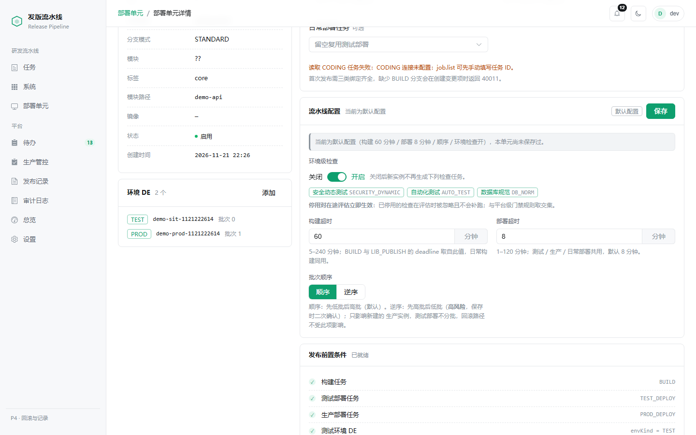
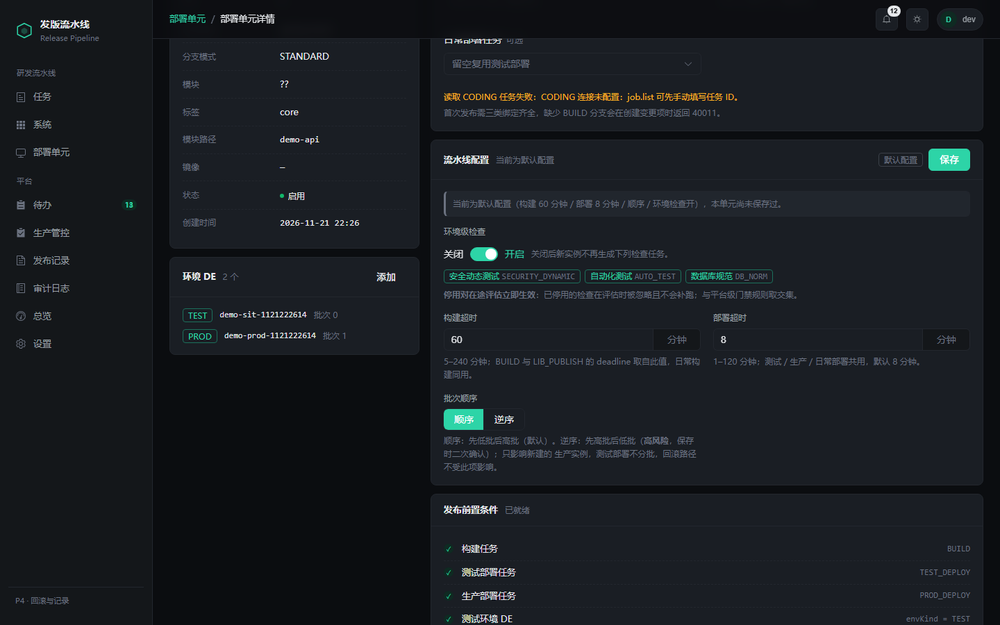

**块位置与结构（`web/src/views/UnitDetailView.vue`）**

- 右栏 `stack` 内、紧跟「CODING 任务绑定」、位于「发布前置条件」之前：`<DataSection class="unit-pipeline" title="流水线配置">`。
- `#actions`：状态 `el-tag`（`默认配置` / `已保存` / `只读`；加载中不显示 tag）+「保存」按钮（无权限时不渲染）。
- 副标题（`pipelineSubtitle`）随状态变化：加载中「读取中…」；只读「仅平台管理员可见」；`configured:false`
  「当前为默认配置」；已保存时 UNIT 为「构建 X / 部署 Y 分钟 · {batchOrderLabel}」，LIB 为「构建超时 X 分钟」，有
  `updatedBy` 时再拼「 · {user} 更新于 yyyy-MM-dd HH:mm」（`formatDateTime`，本地时区、分钟精度）。
- 加载失败只在块内显示 `el-alert`（服务端 message），不阻塞页面其余部分；PageHeader 的「刷新」也重载该块
  （`reloadAll` 调 `loadPipeline()`），进入页面/路由变化时加载一次。

**默认态（`configured:false`）**

- 块内提示原文：「当前为默认配置（构建 60 分钟 / 部署 8 分钟 / 顺序 / 环境检查开），本单元尚未保存过。」
- 表单初始即 60 / 8 / `FORWARD` / 环境检查开；状态标签「默认配置」；**不显示**「最近保存」回显。

**环境级检查（仅 UNIT）**

- `el-switch`（`开启`/`关闭`）+ 一行「关闭后新实例不再生成下列检查任务。」；三个只读标签同时显示中文名与机器值
  （`安全动态测试 SECURITY_DYNAMIC`、`自动化测试 AUTO_TEST`、`数据库规范 DB_NORM`），开关关闭时标签转灰。
- 常驻提示：「**停用对在途评估立即生效**：已停用的检查在评估时被忽略且不会补跑；与平台级门禁规则取交集。」
- 中文名来自页面本地只读映射 `ENV_CHECKS`（机器值是契约）；不复制枚举，服务端新增检查项不会让页面报错。

**超时（分钟）**

- 构建超时：`el-input`（`inputmode="numeric"`）+ 后缀「分钟」，提示「5–240 分钟；BUILD 与 LIB_PUBLISH 的 deadline
  取自此值，日常构建同用。」；部署超时：同样的输入，提示「1–120 分钟；测试 / 生产 / 日常部署共用，默认 8 分钟。」
- 客户端先校验（空白/非整数/越界）：直接 `ElMessage.warning`（如「构建超时需为 5–240 之间的整数分钟」），**不发
  PUT**；服务端 40000 仍是权威校验，错误 toast 用服务端 message。

**批次顺序（仅 UNIT）**

- `el-radio-group` 两个选项：`顺序(FORWARD)`、`逆序(REVERSE)`（Element Plus `label` 传值，仓库统一旧写法）。
- 提示：「顺序：先低批后高批（默认）。逆序：先高批后低批（**高风险**，保存时二次确认）；只影响新建的生产实例，
  测试部署不分批，回滚路径不受此项影响。」
- **二次确认只在把已保存的 `FORWARD` 改成 `REVERSE` 时弹**（`ElMessageBox.confirm`，标题「保存流水线配置」，
  正文含「逆序批次是高风险：先高批后低批，且只影响此后新建的生产实例；测试部署不分批，回滚路径自带逆序、不受此项
  影响。」，确认按钮「确认逆序」/取消「取消」）；已是 `REVERSE` 再保存、或改回 `FORWARD` 都不弹。取消即不保存。

**保存与回显**

- `PUT /api/v1/units/{id}/pipeline-config`，四个字段按契约发**字符串**（`String(envChecksEnabled)`、trim 后的分钟
  字符串、`batchOrder`）；成功后 `fillPipeline(view)` 回填并 `ElMessage.success('流水线配置已保存')`，副标题、状态
  标签与「最近保存：{user} · {time}」立刻更新；失败 `ElMessage.error` 显示服务端 message。
- 全量替换：保存时把当前表单四项一起回传；没有「部分保存」。

**LIB 差异**

- `type === 'LIB'` 时**隐藏**环境级检查、部署超时与批次顺序，只留构建超时，并在块内说明「二方库没有 VERIFY 节点与
  生产部署，环境级检查与批次顺序对它不适用，只保留构建超时（部署超时同样隐藏）。」
- 由于保存是全量替换，LIB 把未展示的三项按**当前加载值原样回传**，改构建超时不会误改开关/部署超时/批次顺序
  （探针用 API 实测断言 `env=true/deploy=8/FORWARD` 不变）。

**只读态（无 `setting:manage`）**

- 块自己查一次 `GET /api/v1/me` 判断 `perms.includes('setting:manage')`（与设置页各功能块同款）。
- 无权限时显示 `restricted`：「需要平台管理员权限」+「流水线配置决定该单元的检查、超时与批次顺序，只有具备
  `setting:manage` 的账号可以查看和修改；当前账号无权读取该配置。」，不渲染保存按钮/开关/输入/单选，状态标签
  「只读」，并且**不向 pipeline-config 端点发任何请求**（连 GET 都不发；该端点对无权限是 40009）。
- 代价：单元详情页多一次 `/me` 请求；`ops-lead` 看不到已存值（只看到原因）。

**API / 类型**

- `web/src/api/index.ts#getPipelineConfig(unitId)` → `GET /api/v1/units/{unitId}/pipeline-config`；
  `savePipelineConfig(unitId, {envChecksEnabled,buildTimeoutMinutes,deployTimeoutMinutes,batchOrder})` → 同路径 PUT，
  body 四字段字符串。
- `web/src/api/types.ts#PipelineConfigView`：`unitId/envChecksEnabled/buildTimeoutMinutes/deployTimeoutMinutes/
  batchOrder/batchOrderLabel/configured` + 可空 `updatedBy/updatedAt`。

**探针与截图（`scripts/verify-p6c-ui.mjs`）**

- 运行（从仓库根拷到 `%TEMP%\rp-shot-tools` 执行，双主题，Edge + Puppeteer）：
  `node %TEMP%\rp-shot-tools\verify-p6c-ui.mjs http://127.0.0.1:5173 --shots docs/design/shots`。
- 覆盖（亮/暗各一遍）：UNIT 默认值/默认态文案/三条检查名 + 机器值/顺序选中/风险提示；范围拒绝（build 4、241，
  deploy 0、121，API 仍 60/8）；保存回显（15/3、`configured:true`、`updatedBy=dev`、状态「已保存」）；逆序确认
  （弹框正文含「高风险：先高批后低批」，确认后 API `REVERSE`；改回顺序不再弹）；LIB 差异（无开关/部署输入/批次
  单选，改 90 后其余三项不变）；只读态（`ops-lead`、无控件、`pipelineRequests=0`）；收尾删行恢复默认；0 console error。
- 探针输出（最终一次，见任务报告）：

  ```text
  initial state: rowDeleted=true unit=60/8/FORWARD/on configured=false lib=60/8/FORWARD configured=false
  p6c-light: unit=60/8/顺序/env=on guards=build4/241,deploy0/121 saved=15/3 reverse=REVERSE->FORWARD lib=build90(hidden ok) restored=60/8/顺序/env=on readonly=yes pipelineRequests=0 errors=0
  p6c-dark: unit=60/8/顺序/env=on guards=build4/241,deploy0/121 saved=15/3 reverse=REVERSE->FORWARD lib=build90(hidden ok) restored=60/8/顺序/env=on readonly=yes pipelineRequests=0 errors=0
  restored: rowDeleted=true unit=60/8/FORWARD/env=on configured=false lib=60/8/FORWARD
  OK all P6-C pipeline-config assertions passed
  ```

**验收（P6-C）**

- `cd web; npm run build`（`vue-tsc -b && vite build`）通过：`✓ built in 995ms`（exit 0，无新依赖）。
- 探针双主题 `OK all P6-C pipeline-config assertions passed`，0 console error；两张 1440×900 截图入库。
- 后端 API 实测（本机 live）：`GET /api/v1/units/2/pipeline-config`（`X-User-Id: dev`）→ `code 0` +
  `configured:false/60/8/FORWARD/updatedBy:null`；`ops-lead` → `code 40009`；未知单元 → `code 40000`。

**与设计不一致（前端，代码为准）**

1. **超时输入用 `el-input`（`inputmode="numeric"`）而非 `el-input-number`**：沿用 P6-B「锁超时」先例
   （`el-input-number` 失焦会把 4 自动夹到 5，页面级「范围拒绝」就无法稳定断言）；非法值点保存直接客户端提示、
   不发 PUT，服务端 40000 兜底。视觉与「锁超时」一致（`分钟` 后缀）。
2. **只读分支不读取数值**：`GET` 对无 `setting:manage` 返回 **40009**（HTTP 200 信封），不是设置页注释里的 403；
   因此按设置页模式**无权限就不发请求**，只显示原因。`ops-lead` 看不到已存值；块为此多查一次 `/me`（设计未写）。
3. **LIB 还隐藏「部署超时」**：设计 §4 只点名隐藏环境检查与批次顺序、只留构建超时；部署超时对库同样不适用
   （无部署），一并隐藏，块内有一句说明。
4. **探针用 dev MySQL 删行恢复默认**：接口没有 DELETE，而收尾要求「恢复默认或删除行」；脚本在每次运行前与
   `finally` 用 `mysql`（`root/root`，`application.yml` 的默认 dev 账号）删 `unit_pipeline_config` 中 2/91001 的行，
   这样才能稳定断言 `configured:false` 与「当前为默认配置」；mysql 不可用时回退 PUT 默认值并跳过「未保存态」断言。
5. **`el-radio-button` 用 `label` 传值**：仓库内（设置页/通知页/生产管控）统一旧写法，本块保持一致，不引入 `value`
   以免风格分裂。
6. **二次确认只在「FORWARD → REVERSE」弹**：设计只说「逆序二次确认」，没说重复保存；代码只在从非 REVERSE 改为
   REVERSE 时弹，避免每次保存都打断。
7. **状态标签、副标题、块内提示文案是实现的补充**：设计只给要点（检查名、风险提示、回显）；具体中文串以代码为准
   （探针断言了副标题/默认态/只读/回显的关键片段）。
8. **PageHeader「刷新」也重载配置块**：设计未写刷新行为；`reloadAll` 增加了 `loadPipeline()`。
9. **中文检查名是本地只读映射**：`ENV_CHECKS` 与 P6-B 的 `GATE_CHECKS` 同款，机器值是契约；`batchOrderLabel` 由
   服务端给，页面不翻译枚举。

**未做（P6-C 明确不做）**

- **不做节点编排/只读拓扑图**：页面只是一个配置项表单，四节点主干固定（设计 §6；IA #8 的「节点编排」未实现）。
- **没有删除/「恢复默认」按钮**：恢复默认要手工改回 60/8/顺序/开，或由运维删行（无 DELETE 端点）。
- **不提供审计查看入口**：保存留痕在全局审计页（`SETTING_UPDATE`）。
- **不显示历史停用检查行**：验证确认面板负责「已停用」标记，本块只配置。
- **没有前端单测**：覆盖靠 `scripts/verify-p6c-ui.mjs`；**截图未人眼复核**（文档轮模型无图像输入）。
- **未在真实 CODING 环境验证**：本块只写配置；「保存后发布生成新实例」的效果由后端测试覆盖，未做端到端发布取证。

## 21. P6-D · 紧急放行（2026-11-26）

GAP-11 / J11 的前端是一个**页头红色入口 + 红色确认框 + 常驻红色横幅**，记录页加一枚红色 chip。**不新增路由、
不新增导航、不新增依赖**：发布内容页 `ReleaseView.vue`、发布记录页 `RecordsView.vue`，复用既有
`ReasonDialog`（新增可选 `warningType`）与 `AdmissionPanel`（新增 `emergency` prop）。接口与后端口径见技术方案
§8.16 / §12.2.13。

截图（`git add -f`，全页 1440×2351，两张都是**真实放行后**的状态）：

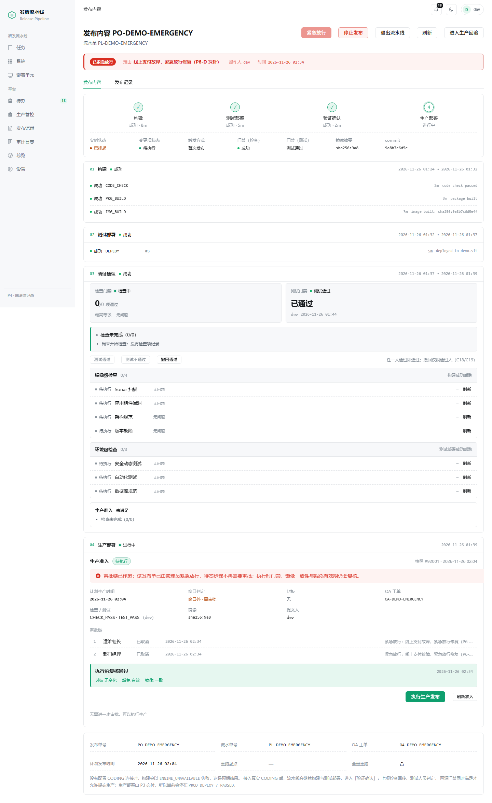
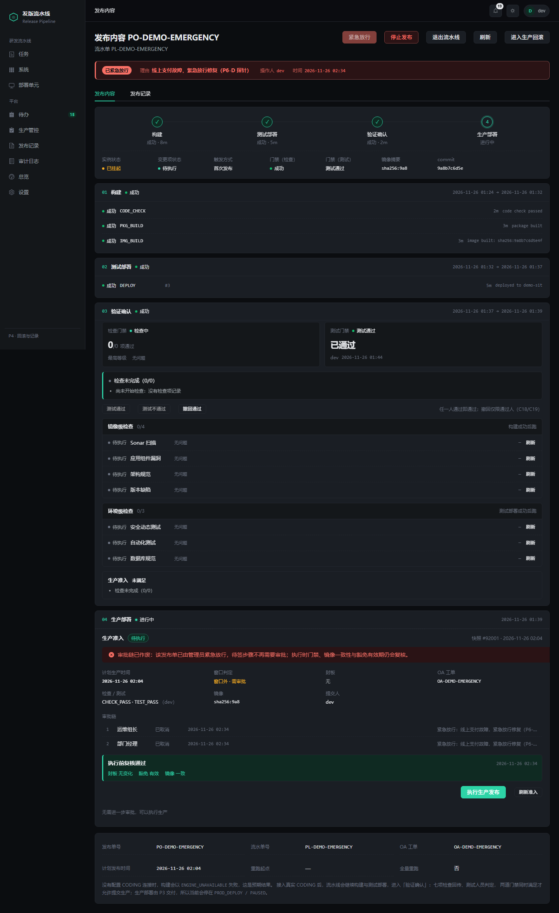

**页头按钮（`ReleaseView.vue`）**

- 位置：`PageHeader` 的第一个按钮（`紧急放行` 之后才是 `停止发布`/`退出流水线`/`刷新`/`进入生产回滚`）；类
  `.emergency-release`、`type="danger"`，文案固定「紧急放行」。
- **显示/隐藏**：只有 `GET /me` 返回的 `roles` 含 `ADMIN` 才**渲染**（`v-if="isAdmin"`）；非 ADMIN **不是 disabled**，
  是整颗按钮不存在（`ops-lead` 的 OPS + OPS_LEAD 也看不到）。页面不查 `control:approve`，与后端「仅 ADMIN 角色」
  同口径。
- **禁用规则**（`emergencyBlock` 计算属性，按顺序取第一条；结果非空即禁用，并作为 `title` 说明原因）：
  1. `正在读取权限`（`/me` 未回）；
  2. `无法读取当前身份（GET /me）`；
  3. `正在读取变更项状态`（admission 未回）；
  4. `无法读取变更项状态（GET admission）`；
  5. 已放行（`emergencyRelease === 'true'`）→「该发布单已紧急放行；不可撤销，再次发布请走重跑」；
  6. `itemStatus === 'READY'` →「已经是待执行状态，无需紧急放行」；
  7. 其它状态 →「当前状态「{中文标签}」不可紧急放行；仅「已提交」「待审批」可用，其它状态请先正常提交或重跑」。
  可放行时 `title` 是能力说明：「仅管理员：作废待签审批并置为「待执行」；不绕过门禁、镜像与豁免复核」。
- 因此**不合格状态仍显示按钮**（只是 disabled + 原因），避免「按钮消失 = 没有这个功能」；只有**角色不合格才是隐藏**。
- `busy`（请求在飞）时也禁用。点击只打开确认框，不发请求。

**确认框（复用 `ReasonDialog`，`warningType="error"`）**

- 标题「紧急放行」；正文：「将紧急放行发布单 {publishNo}：作废审批链上全部待签步骤（留痕「紧急放行：理由」），
  变更项置为「待执行」。」
- 红色警示（`el-alert--error`，仅此处传 `error`，停止/退出等既有弹窗仍是黄色 `warning`）：「仅管理员可用且不可撤销：
  会写红色标识、审计与通知。执行时只跳过审批与封板等待，门禁检查、镜像一致性与豁免有效期仍会复核。」
- 理由输入：`textarea` 3 行、`maxlength=200` + 字数统计、占位「说明为什么紧急放行，例如：线上支付故障，需立即修复
  上线」；空/超长时确认按钮禁用（`canConfirm`），底部提示「原因必填，1–200 字，作为操作留痕」。
- 确认按钮文案「确认紧急放行」、`danger` 态、`busy` 时转圈防重复点击。
- 成功：`ElMessage.warning('已紧急放行：变更项 {标签}，审批链已作废；执行时门禁、镜像与豁免仍复核')`，关框并刷新；
  `40001`：提示服务端 message、关框并刷新（状态已变，避免留下可点的旧动作）；其它错误只 toast，框保持打开并保留
  已输入理由以便重试。

**已放行横幅（`ReleaseView.vue`）**

- `emergencyRelease === 'true'` 时页头下方常驻 `<div class="emergency-banner" role="alert">`：红色徽标「已紧急放行」+
  三段「理由 / 操作人 / 时间」（时间走 `formatDateTime`，本地时区到分钟）；缺失值显示 `—`。
- 横幅与按钮并存：按钮此时 disabled（title 说明不可撤销）。执行按钮文案仍是「执行生产发布」，页面不额外拦截——
  后端只跳过封板等待，镜像/门禁/豁免仍会拒绝，前端不重复判断。

**审批链作废展示（`AdmissionPanel.vue`）**

- 新增 `emergency?: boolean` prop；为真时在生产准入面板顶部渲染红色 `el-alert`（类 `.admission-emergency`）：
  「审批链已作废：该发布单已由管理员紧急放行，待签步骤不再需要审批；执行时门禁、镜像一致性与豁免有效期仍会复核。」
- 被作废的步骤由后端给出 `CANCELED`，面板按既有链渲染（每条显示「已取消」+ comment「紧急放行：理由」）；
  另有封板告警时两条 alert 都显示（封板不阻断的事实不隐藏）。
- 父组件给 `AdmissionPanel` 的 `:key` 改为 `isEmergency ? 'admission-emergency' : 'admission-normal'`：放行成功后
  父页面刷新只换 props、不重挂子组件，链会残留 `PENDING`；`key` 变化强制重挂并重新拉 admission（视觉无变化）。
- 根节点补 `admission-panel` 类，只供探针定位，不影响样式。
- Element Plus 的 `type="error"` 用自带的 `--el-color-error`（默认 `#f56c6c`），项目 tokens 只有 `--danger`；在两处
  红色警示上**局部**把 `--el-color-error*` 绑到 `--danger` / `--danger-weak`（`ReasonDialog`、`AdmissionPanel`），
  不改全局色板，也不影响其它 error alert。

**发布记录页 chip（`RecordsView.vue`）**

- 行内「发布单」列（`min-width` 190→210）在发布单号后追加红色 chip：`status-chip chip-danger emergency-chip`，
  文案「紧急放行」；`emergencyRelease === 'true'` 才渲染。
- `el-tooltip` 内容由 `emergencyHint(row)` 拼：「理由：… · 操作人：… · 时间：…」（缺失段跳过；都没有时只显示「紧急放行」）。
- 不新增独立列（否则整表多一列空值），理由/操作人/时间只在 hover 中出现。

**API / 类型**

- `web/src/api/index.ts#emergencyRelease(publishNo, reason)` → `POST /api/v1/releases/{publishNo}/emergency-release`；
  `web/src/api/types.ts`：`EmergencyResult{status,itemStatus,emergency:boolean}`（响应的 `emergency` 是 **JSON boolean**）；
  `ReleaseDetail` / `ReleaseRecordRow` 加**可选**四字段 `emergencyRelease?: string`、`emergencyReason?/emergencyBy?/
  emergencyAt?: string | null`（旧后端无字段时页面按未放行处理）。

**探针与截图（`scripts/verify-p6d-ui.mjs` + `scripts/demo-emergency.sql`）**

- 运行（从仓库根目录解析 `scripts/demo-emergency.sql` 与 `--shots`；`puppeteer-core` 只在该 scratch 目录可解析，
  故把脚本拷到 `%TEMP%\rp-shot-tools` 执行）：
  `node %TEMP%\rp-shot-tools\verify-p6d-ui.mjs http://127.0.0.1:5173 --shots docs/design/shots`。
- 种子：`PO-DEMO-EMERGENCY`（item 92001 `PENDING_APPROVAL`、两条 `PENDING` 审批、实例 `PAUSED` 在 `PROD_DEPLOY`、
  镜像 digest 与快照一致），同时幂等创建 `dev`（ADMIN）与 `ops-lead`（OPS + OPS_LEAD，无 ADMIN）；脚本在**运行前、
  每个主题前、finally 各重播种一次**，并在 finally 断言恢复成 `emergencyRelease=false / itemStatus=PENDING_APPROVAL /
  chain=PENDING/PENDING`，否则退出码非 0。
- 覆盖（亮/暗各一遍）：非 ADMIN 无按钮/无横幅/零 POST；ADMIN 按钮存在、可用、`--danger` 背景（light `#d92d20` /
  dark `#f97066`）、title 含「仅管理员」；确认框标题/红色警示（含「不可撤销」「门禁」）/danger 确认/空理由禁用/
  输入后启用；**真实 POST 一次**（toast、横幅含理由/`dev`/时间、按钮转 disabled、准入面板「审批链已作废」+ 两步
  `CANCELED` + comment 含理由、执行按钮仍为「执行生产发布」）；API + MySQL 回读（详情四字段、`itemStatus=READY`、
  `orderStatus=READY`、`release_order.emergency_release=1`、历史 1 行、`CANCELED` 2 行）；`READY` 单按钮 disabled +
  title「已经是待执行状态」；记录页 chip 颜色 = `--danger`、hover 出现含理由与操作人的 tooltip；0 console error。
- 探针输出（最终一次，见任务报告）：

  ```text
  seed: PO-DEMO-EMERGENCY reset to PENDING_APPROVAL
  initial state: itemStatus=PENDING_APPROVAL chain=PENDING/PENDING emergencyRelease=false
  p6d-light: readonlyHidden=true doorDanger=rgb(217, 45, 32) posts=1 dialogRed=true item=READY chain=CANCELED/CANCELED canceled=2 history=1 readyDoorDisabled=true chip=rgb(217, 45, 32) tooltip=yes frame=157..2116 of 2351 errors=0
  p6d-dark: readonlyHidden=true doorDanger=rgb(249, 112, 102) posts=1 dialogRed=true item=READY chain=CANCELED/CANCELED canceled=2 history=1 readyDoorDisabled=true chip=rgb(249, 112, 102) tooltip=yes frame=157..2116 of 2351 errors=0
  restored: emergencyRelease=false itemStatus=PENDING_APPROVAL chain=PENDING/PENDING
  OK all P6-D emergency-release assertions passed
  ```

**截图口径：为什么是全页 1440×2351（不是既有 1440×900）**

- 页头红色横幅在页面顶部（探针实测横幅顶 `y≈157`），被作废的审批链在生产节点面板里（面板底 `y≈2116`）；1440×900
  的视口截图无法同时呈现「红色横幅 + 审批链已作废 + 两条已取消」，而这张图要证明的正是「放行后页面处处留痕」。
- 因此用 `page.screenshot({fullPage:true})`：宽度仍是 1440，高度取整页滚动高度 2351，`frame=157..2116 of 2351`
  就是探针实测的横幅顶 / 面板底 / 整页高。代价是与既有各切片 900 高的截图不统一；若要统一，需改裁切或滚动拼接。

**验收（P6-D）**

- `cd web; npm run build`（`vue-tsc -b && vite build`）通过：1675 modules，`built in 1.01s`（exit 0，无新依赖；
  Task 2 报告的结果，lead 又独立重跑一遍亦绿，`web/dist` 产物时间 02:34:38）。
- 探针双主题 `OK all P6-D emergency-release assertions passed`，0 console error；两张全页截图入库（1440×2351）。
- 真实放行两次（每主题一次）后数据库已由脚本重播种：`PO-DEMO-EMERGENCY` 回到 `PENDING_APPROVAL` /
  `emergencyRelease=false` / 两条 `PENDING` 审批 / 0 条历史；admission 与 detail 两侧都断言过。

**与设计不一致（前端，代码为准）**

1. **截图是全页 1440×2351，不是既有 1440×900**：设计只要求「亮/暗双主题截图」，没规定尺寸；为让横幅与作废审批链
   同图可见，改用全页截图（原因见上）。
2. **复用 `ReasonDialog` 并新增 `warningType`，不是新建组件**：设计只写「确认框含红色警示」；为了不复制一套确认框，
   给共享组件加可选 `warningType: 'warning' | 'error'`（默认 `warning`），停止/退出/归档/关闭的黄色警示与其截图不变。
3. **红色来自 `--danger`，但 Element Plus 用自己的 `--el-color-error`**：项目 tokens 没有 `--el-color-error`，若直接用
   `type="error"` 会得到 Element 的 `#f56c6c`，与 `--danger`（light `#d92d20` / dark `#f97066`）不一致；因此在两处红色
   警示上**局部**把 `--el-color-error*` 绑到 `--danger`/`--danger-weak`，不新增色板、不改全局。
4. **不合格状态是「显示但禁用」，不是隐藏**：设计只说「仅 ADMIN 显示」，代码把「角色不合格」（隐藏）与「状态不合格」
   （disabled + title 原因）分开；后者仍在页头，避免被读成功能缺失。
5. **已放行后按钮不消失、改为 disabled**：设计只说「已放行时显示横幅」；代码保留按钮并用 title 说明「不可撤销，再次
   发布请走重跑」，与横幅并存。
6. **记录页 chip 在「发布单」列内，不是新增一列**：设计只说「行内红色 chip」；实现挂在发布单号后（列宽 190→210），
   理由/操作人/时间只在 hover tooltip。
7. **准入面板用 `:key` 重挂才刷新审批链**：设计未写刷新机制；父页面 `load(true)` 只换 props，子面板不会重新拉
   admission，故用 `key` 强制重挂（`admission-emergency`/`admission-normal`），视觉无变化。
8. **`AdmissionPanel` 根节点加 `admission-panel` 类**：设计未写；只为探针定位（既有类 `admission` 保留）。
9. **横幅时间是本地时区到分钟**：`formatDateTime`（与全站一致），不是 ISO-8601 原文；详情接口给的仍是 ISO-8601。

**未做（P6-D 前端明确不做）**

- **没有「撤销紧急放行」入口**：无接口、无按钮，横幅永久保留（设计 §6）；再次发布走重跑。
- **不展示历史表**：记录页/详情只显示订单列上的最近一次；`emergency_release` 历史无读接口，页面不显示「第几次」。
- **不额外拦截执行**：已放行页面的「执行生产发布」仍可点，镜像/门禁/豁免由后端拒绝并回显 message；前端不预判。
- **没有前端单测、截图未人眼复核**：覆盖靠 `scripts/verify-p6d-ui.mjs` 的双主题 DOM 断言；模板轮文档模型无图像输入，
  未人工看图（尺寸 1440×2351 由文件读取核实）。
- **只验证 demo 单**：探针只对 `PO-DEMO-EMERGENCY` 真实放行，未在其它真实发布单上跑「放行 → 执行 → 观察批次」；
  执行侧由后端 5 个测试覆盖。

## 22. P6-E · 审批时效（2026-11-26）

GAP-12 / J7 的前端是设置页的**第四块**「审批时效」：一个开关 + 两个小时数 + 客户端校验 + 保存回显，
位于「锁超时」之后、「外观」之前。**不新增路由、不新增导航、不新增依赖**：只改 `web/src/views/SettingsView.vue`
与 `web/src/api/{index,types}.ts`。接口与后端口径见技术方案 §8.17 / §12.2.14。

截图（`git add -f`，视口 1440×900，块滚到页面顶部）：

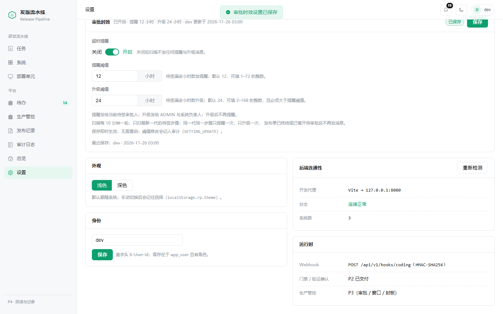
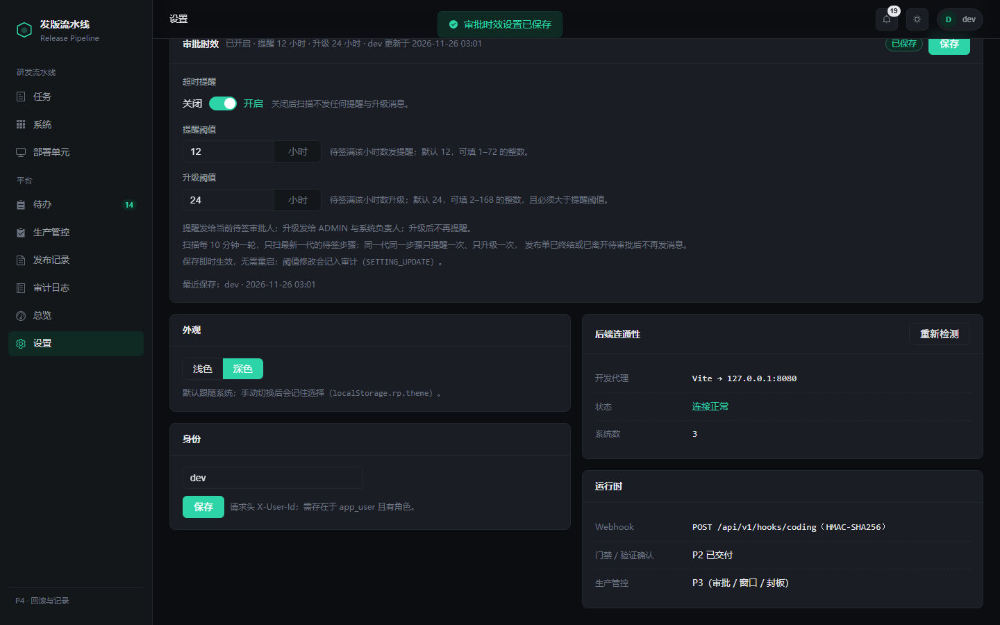

**块结构（`SettingsView.vue`，类 `.settings-approval`）**

- `DataSection` 标题「审批时效」；右上 `#actions`：状态 chip + 「保存」按钮（类 `.approval-save`，仅
  `settingsCanManage` 渲染）。整块在 P6-B 的「锁超时」块之后、「外观」网格之前（`margin-bottom: 16px`）。
- chip 五态：`读取中…`（`settingsLoading`）/ `只读`（无 `setting:manage`）/ `已关闭`（`enabled=false`）/
  `已保存`（有 `updatedBy`）/ `默认开启`（种子，`updatedBy=null`）。
- subtitle 回显：`已开启|已关闭 · 提醒 N 小时 · 升级 M 小时`；有 `updatedBy` 时追加 `· {updatedBy} 更新于 {时间}`
  （`formatDateTime`，本地时区到分钟），否则追加 `· 默认配置`；未加载时 `读取中…`，只读时 `仅平台管理员可见`。
- 读取失败：块内 `el-alert type="error"`，title 为 `API message`，回退文案「读取审批时效配置失败」。
- 控件：
  - 「超时提醒」`el-switch`（类 `.approval-enabled`，`active-text=开启`/`inactive-text=关闭`），旁注
    「关闭后扫描不发任何提醒与升级消息。」
  - 「提醒阈值」`el-input`（类 `.approval-hours.approval-remind`，`inputmode=numeric`、`#append 小时`、
    placeholder `12`），旁注「待签满该小时数发提醒；默认 12，可填 1–72 的整数。」
  - 「升级阈值」`el-input`（类 `.approval-hours.approval-escalate`，同上，placeholder `24`），旁注
    「待签满该小时数升级；默认 24，可填 2–168 的整数，且必须大于提醒阈值。」
- 提示区 `.field.hint.approval-hint` 三句：brief 要求的三句（「提醒发给当前待签审批人；升级发给 ADMIN 与
  系统负责人；升级后不再提醒。」）之外，另补扫描口径（「扫描每 10 分钟一轮，只扫最新一代的待签步骤：同一代
  同一步骤只提醒一次、只升级一次，发布单已终结或已离开待审批后不再发消息。」）与审计说明（保存即时生效、
  阈值修改记入 `SETTING_UPDATE`）。
- 回显：`updatedBy` 非空时块底 `.approval-audit` 显示「最近保存：{updatedBy} · {时间}」。
- 只读分支（无 `setting:manage`）：整块显示虚线框 `.restricted`「需要平台管理员权限 / 只有具备
  `setting:manage` 的账号可以查看和修改；当前账号无权读取该配置。」，**不渲染**开关、阈值输入、保存按钮，
  且**不发**该端点的 GET（见探针断言）。

**客户端校验（`approvalProblems` → `approvalInvalid` → `approvalReason`）**

- 输入用 `string` + `parseHours`（`/^\d+$/` 且 `Number.isSafeInteger`，不接受小数/负数/空/前后空格外的字符），
  不做 `el-input-number`：保留用户输入原文，才能解释「为什么不能保存」。
- 三条规则各产出一句中文原因，可同时命中、用「；」连接：
  1. 提醒阈值不是 1–72 的整数 →「提醒阈值需为 1–72 之间的整数小时（当前 X）」（空值显示「空」）；
  2. 升级阈值不是 2–168 的整数 →「升级阈值需为 2–168 之间的整数小时（当前 X）」；
  3. 两者都是整数且 `escalate <= remind` →「升级阈值必须大于提醒阈值（当前 E ≤ R）」。
- 任一不满足：块内 `el-alert type="warning"`（类 `.approval-invalid`）title 为
  「当前设置不可保存：…」、`保存` disabled；`saveApproval()` 另有一道 `ElMessage.warning` 兜底（`approvalInvalid`
  或 `parseHours` 为 `null` 时直接返回，不发 PUT）。
- 合法时 `saveApprovalSetting({enabled, remindHours, escalateHours})` → `fillApproval(view)` 回填
  （chip/副标题/audit 行随之更新）、`ElMessage.success('审批时效设置已保存')`；失败只 toast
  `API message`（回退「保存审批时效设置失败」），不关闭块、保留输入。

**只读口径（沿用 P6-B 平台设置片）**

- 审批时效是 P6-B 平台设置的**第四块**，复用同一个 `loadPlatformSettings()`：一次 `GET /me` 判
  `setting:manage`，有权限才用 `Promise.allSettled` 并发 **四路** GET（gate/approvers/lock/approval）；
  无权限**连 GET 都不发**（后端读也 40009），块内只显示权限原因。没有为审批时效另起 loader、也不各自再读 `/me`。
- 只读用户看不到阈值数值（不是 disabled 控件）：块内不渲染任何控件，`controls=0`。

**API / 类型**

- `web/src/api/index.ts`：`getApprovalSetting()` → `GET /api/v1/settings/approval`；
  `saveApprovalSetting(body)` → `PUT` 同路径（`body` 为 `{enabled, remindHours, escalateHours}`，全量替换）。
- `web/src/api/types.ts`：`ApprovalSettingView{enabled:boolean; remindHours:number; escalateHours:number;
  updatedBy?: string | null; updatedAt?: string | null}`。

**探针与截图（`scripts/verify-p6e-ui.mjs`）**

- 运行（`puppeteer-core` 只在 scratch 目录可解析，故把脚本拷到 `%TEMP%\rp-shot-tools` 执行；脚本不依赖 MySQL，
  只走 HTTP API）：

  ```text
  copy scripts\verify-p6e-ui.mjs %TEMP%\rp-shot-tools\
  node %TEMP%\rp-shot-tools\verify-p6e-ui.mjs http://127.0.0.1:5173 --shots docs/design/shots
  ```

- 探针在**运行前与 `finally` 各一次** PUT `enabled=true / 12 / 24` 并读回校验（否则退出码非 0），因此可重复运行；
  它不重播种 SQL、不改 `user_role`（与 P6-D 的探针不同）。
- 覆盖（亮/暗各一遍，`expect()` 全为硬断言）：
  1. 块存在且标题「审批时效」、默认 `12 / 24`、开关 on、保存可用、无非法提示、subtitle 含「提醒 12 小时 /
     升级 24 小时」、三段文案含「提醒发给当前待签审批人」「ADMIN 与系统负责人」「升级后不再提醒」、块确实发过 GET；
  2. 非法拦截：提醒 `0` → 块内可见原因含 `1–72`、保存 disabled、**无 PUT 离开**、API 仍 12/24；提醒 12 /
     升级 12 → 原因含「必须大于提醒阈值」、保存 disabled、无 PUT；升级 `169` → 原因含 `2–168`、保存 disabled、无 PUT；
  3. 保存回显：合法 `6/12` → toast、API 读回 `true/6/12`、页面 6/12、chip `已保存`、subtitle 6/12、
     `.approval-audit` 含 `dev` 与时间戳；开关关 → 保存 → API `enabled=false`、chip `已关闭`、subtitle「已关闭」；
     开关开 + `12/24` → 保存 → API `true/12/24`、页面 12/24、subtitle 12/24；
  4. 截图断言：`.settings-approval` `scrollIntoView({block:'start'})` 后整块落在视口内（`top>=-1 && bottom<=901`）；
  5. 只读：`ops-lead`（OPS + OPS_LEAD，无 `setting:manage`）打开 `/settings` → 块内「需要平台管理员权限 /
     setting:manage」、无保存按钮、无开关/输入框（`controls=0`）、阈值不渲染、对该端点请求数 **0**；
  6. 每主题 assert 0 console error；`finally` 再 PUT + 读回 `enabled=true / 12 / 24`。
- 探针输出（最终一次，见 Task 2 报告）：

  ```text
  initial GET: enabled=true remind=12 escalate=24 updatedBy=-
  defaults: enabled=true remind=12 escalate=24
  p6e-light: block=审批时效 defaults=12/24 guard=0/12eq/169 puts=3 saved=6/12 off=false restored=true/12/24 readonly=yes approvalRequests=0 errors=0
  p6e-dark: block=审批时效 defaults=12/24 guard=0/12eq/169 puts=3 saved=6/12 off=false restored=true/12/24 readonly=yes approvalRequests=0 errors=0
  restored: enabled=true remind=12 escalate=24
  OK all P6-E approval-reminder settings assertions passed
  ```

- 截图口径：两张都是 **1440×900 视口截图**（不是整页），拍摄前把 `.settings-approval` 滚到视口顶部，与 P6-B
  `settings-rules-*.png` 同一取景方式；大小浅色 94,463 B / 深色 93,685 B。拍摄时是**已保存 12/24 且开关开启**的
  状态，chip 为「已保存」、audit 行显示 `dev`。代价：看不到页面其它块；若要整页图需改 `fullPage`，但会把无关
  块一起带进来。

**验收（P6-E）**

- `cd web; npm run build`（`vue-tsc -b && vite build`）通过：`built in 1.03s`、exit 0、无新依赖（Task 2 报告）；
  构建产物 `web/dist/` 被 gitignore，未入库。
- 探针双主题 `OK all P6-E approval-reminder settings assertions passed`，0 console error；结束态
  `enabled=true / 12 / 24`。
- 两张截图入库（1440×900，`git add -f`）；前端提交 `516a680`（6 文件，+743/−5）。
- 后端 30 个测试 / 全量 994 绿见技术方案 §8.17。

**与设计不一致（前端，代码为准）**

1. **块内容比设计多**：设计 §2 只写「开关 + 两个小时数」。实现另加状态 chip、subtitle、`updatedBy/updatedAt`
   回显、块内可见的非法原因 `el-alert`、三条提示与「最近保存」行；这些是 P6-B 三块的既有呈现口径，保持一致。
2. **阈值输入是字符串 `el-input`，不是 `el-input-number`**：为了保留用户输入原文并解释原因（空/小数/负数都
   归为「整数小时」违规）；与「锁超时」块的文本输入风格一致。服务端仍按整数校验。
3. **客户端校验比 brief 的两条多一条**：除「提醒 1–72」「升级 > 提醒」外，还拦截「升级 2–168」（探针用 169
   验证）；三条规则可同时命中，原因合并展示。保存前还有一道 toast 兜底。
4. **复用 P6-B 的 `settingsCanManage` 与 `Promise.allSettled` 四路 GET**：审批时效并入平台设置片，而不是像
   CODING/消息通知那样各自再读 `/me`；改动只在加载器注释与数组，既有三块行为不变。
5. **探针结束后 `updatedBy` 由 `null` 变为 `dev`**：`finally` 用 PUT 恢复 `enabled/12/24`，后端按 `SETTING_UPDATE`
   记录更新人/时间，因此再打开页面 chip 显示「已保存」而不是「默认开启」，audit 行带上 `dev` 与时间；
   **数值与开关是默认态**，仅元数据非空（与 P6-B 探针同源，API 无法还原 `null`）。
6. **截图只截视口 1440×900 且把块滚到顶部**：设计只要求「亮/暗截图」，未规定尺寸/取景；与 P6-B
   `settings-rules-*` 一致。代价是看不到页面其它块（如外观/消息通知），块本身完整（探针断言 `top>=-1 &&
   bottom<=901`）。
7. **文案补了扫描口径与审计说明**：brief 只要求三句接收人/抑制语义。实现另写「10 分钟一轮、只扫最新一代、
   同代同步骤只一次、发布单终结或离开待审批后不发」与「保存即时生效、阈值修改记入 `SETTING_UPDATE`」，
   避免用户误解为「每 10 分钟重复提醒」。
8. **只读用户看不到阈值数值**：沿用 P6-B「无权限连 GET 都不发」的口径，只读块只有权限原因，不显示当前
   配置（不是 disabled 的控件）。设计未规定只读呈现。
9. **探针不依赖 MySQL、不改 `user_role`**：只走 HTTP API 并在前后恢复默认；与 P6-D 探针的重播种方式不同
   （P6-E 没有业务数据需要构造，扫描由后端固定时钟测试覆盖）。

**未做（P6-E 前端明确不做）**

- **没有「立即扫描一次」按钮**：扫描是后台任务，页面只配置阈值；手动触发需要新端点与权限，未在设计内。
- **不展示提醒/升级历史**：通知中心按 P4-B 展示通知行，设置页不列「谁在何时收到过」。
- **不预览接收人名单**：页面只解释规则（当前审批人 / ADMIN + 系统负责人），不实时解析会发给谁。
- **升级组不可配**：与设计 §5 一致，页面只有两个阈值与开关，没有「升级对象」编辑器。
- **无前端单测、截图未人眼复核**：覆盖靠 `scripts/verify-p6e-ui.mjs` 双主题 DOM 断言；模板轮文档模型无图像
  输入，两张 1440×900 截图只核对了尺寸与文件大小，未人工看图。
- **不改变 P6-B 三块**：门禁/审批人/锁超时的行为、文案与截图不变；审批时效只是第四块。
## 23. P6-F · 页面补齐：批量部署 / 人员列 / 豁免默认（2026-11-26）

对应需求 PART-02（FR-B-02 批量部署）、PART-03（FR-P-01 人员列）、PART-06（J10 豁免默认有效期）；契约
`docs/superpowers/specs/2026-11-26-p6f-part-fill-design.md`。

### 23.1 批量部署（任务详情页）

- 变更项表加 selection 列：**只有 `PENDING`（待发布）状态可勾选**——这是状态机唯一可发起 `PUBLISH` 的状态
  （`FAILED` 走重跑、在途不可再发布）；比设计原文「DONE 不可勾选」更窄，被勾选行的语义就是「点发布会成功」。
- `DataSection #actions` 的「批量发布（N）」按钮：空选择禁用并提示先勾选；无 `release:publish` 权限禁用并给原因。
- 确认框（`ElMessageBox.confirm`）写明：**串行发布、逐项创建发布单、某项失败不中断后续项、结束后成败摘要**。
- 执行：串行逐项调既有 `publishItem`（每项一个 `POST /items/{id}/publish`，行级 loading 复用 `publishing`）；
  结束后清空选择、刷新列表，全部成功 toast「批量发布完成：N 项全部成功」，部分失败 `ElMessageBox.alert`
  「成功 N 项，失败 M 项。失败明细：<CRID：原因>；…」。**不做后端批量端点**（设计取舍：逐项的锁/门禁/审计
  语义与单条完全一致）。

### 23.2 发布单人员列（发布内容页）

- `ReleaseDetail.testers/deployers`（服务端：任务成员 `TEST/OPS` 角色按 userId 排序，常驻空数组）渲染为
  头部「测试人员 / 部署人员」两个 summary-item：文本拼接 `name 或 userId`，title 展开全部工号，空态 `—`。
- 纯只读：权限仍是 `release:*` / `control:*`，与人员无关。

### 23.3 豁免默认有效期（设置页 + 豁免对话框）

- 设置页「门禁规则」块内新增「豁免默认有效期（天）」：独立字段 + 独立保存（`GET/PUT /api/v1/settings/waiver`，
  1–90 整数客户端校验、禁用保存于非法值），下方「最近保存」行；读失败进块内 error alert。它属于门禁规则块
  （J10），但 API 是自己的端点，与块内「检查开关」分开保存。
- `VerifyPanel` 豁免对话框「有效期（天）」可清空：留空提交时不传 `expireAt`（服务端按 `WAIVER.defaultDays`
  计算），输入旁提示「留空则使用平台默认有效期（设置 → 门禁规则可配）」；显式 1–90 仍客户端计算。

**探针**：`scripts/verify-p6f-ui.mjs`（种子 `demo-batchpublish.sql`：PENDING×2 + DONE×1，失败项为无绑定的
91002 单元走真实服务端拒绝）双主题绿、0 console error；截图 `batch-publish-{light,dark}.png`（勾选态）、
`settings-waiver-{light,dark}.png`（门禁块 + 豁免字段）。

**明确不做（P6-F 前端）**：无后端批量端点与进度持久化（中途刷新丢进度，已建发布单不丢）；豁免对话框不预读
当前配置天数；人员列不做悬停卡片。

## 24. P6-G · 单 DE 重部署与任务日志（2026-11-26）

对应需求 PART-04；契约 `docs/superpowers/specs/2026-11-26-p6g-redeploy-logs-design.md`。

### 24.1 生产任务行与「重新部署」（发布内容页）

- **节点模板重构**：`PROD_DEPLOY` 节点改为「生产准入面板 + 部署任务行」并排（此前 AdmissionPanel 独占该
  节点，任务行不可见）；`VERIFY`/`LIB_SECURITY` 仍只渲染各自面板，其余节点照旧渲染任务行（`PENDING` 节点显示
  「N 项任务等待执行」）。
- 生产 `DEPLOY` 任务行尾部「重新部署」按钮（reason 字符串模式）：无 `control:execute-prod` → 权限原因；
  任务非 `FAILED/TIMEOUT` →「只有失败或超时的任务可以重新部署；成功批次请走重跑或回滚」；变更项非
  `FAILED/PROD_DEPLOYING` → 状态原因。构建/测试/入库任务行不渲染该按钮。
- 确认框写明规则：**同批次 DE 一起重试、其余批次跳过；沿用上一实例镜像、不重新构建；未完成检查将失效，需要
  重新检查**。成功 toast「已创建重跑实例 <pipelineNo>：批次 N 整批重试（目标 <deName>）」+ `load(true)`；
  40001（状态已变）关确认框并重读。

### 24.2 「日志」抽屉（发布内容页）

- 每个有引擎作业的任务行（`CODE_CHECK/PKG_BUILD/IMG_BUILD/DEPLOY/LIB_PUBLISH`）渲染「日志」；`CHECK` 类
  任务不渲染（无引擎作业，服务端也 40001）。
- 抽屉（640px、专属 `log-drawer` 类与回滚抽屉区分）：头部为任务类型 + 批次/目标；正文等宽 `pre`（`surface-3`
  底）追加渲染每页文本；**引擎失败显示服务端文案**（如「CODING 连接未配置：build.logs」的红色 alert）。
- 分页按契约：一次一页（`offset += limit`，「加载更多」只在 `truncated` 时可用），「刷新」重置回第一页；
  `truncated` 的口径是「整页即可能有下一页」。

**探针**：`scripts/verify-p6g-ui.mjs`（种子 `demo-redeploy.sql`：批 1 成功 + 批 2 失败，清理自身实例与旧锁）
双主题绿、0 console error：按钮条件与禁用原因（含无权限视角）、确认文案、一次真实 `POST`（详情 API 回
`RERUN_FROM_NODE`、批 1 `SKIPPED`、批 2 重试）、日志抽屉引擎文案；截图 `redeploy-{light,dark}.png`。

**明确不做（P6-G 前端）**：不做单 DE 粒度（整批重试）；不做历史实例日志查询（外链直达 CODING）；日志不缓存
不落库；无前端单测（覆盖靠 27 个后端测试 + 双主题探针）。
